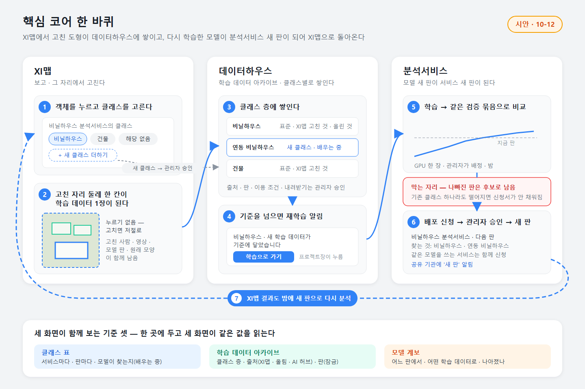

# 설계 23차 · 핵심 코어 — XI맵 · 데이터하우스 · 분석서비스 한 몸 (원칙 205 · 코어 C1 · C5 · C2)

브리핑 확인: (1) **확인받고 만든다 · 코드 수정 0** — 원칙 205(10-12 XI맵-그자리고치기 '다시')의 심층 설계와 검토 자료까지만. 서버 · 화면 코드는 읽기만(다른 오퍼스 둘이 XI맵 그리기 · 확인 기록 빼기를 고치는 중), 서버 DB 는 읽기만, GPU 0, 확인 페이지 안 만듦(now 용 items.json). (2) **숫자 한 출처 · 지어낸 숫자 0** — 숫자는 10-12 서버 DB 에서 직접 센 값(고친 것 0 · 모델 하나를 서비스 넷이 함께 씀 · 남원 모델 '비닐하우스_다동')과 지난 설계의 센 값. 기준 장수 등은 '제안'으로 적었고, 그림의 숫자 자리는 n으로 비웠다. (3) **원칙 203 · GPU** — '다 봤음' 같은 확인 단추 없이 고치면 저절로 학습 데이터가 되게 했고, 학습 · 비교 · 다시 분석은 작업 대기열 · 관리자가 배정한 GPU 한 장 · 밤으로만.

> 사용자(10-12): "어떤 분류인가요? 가 아니라. 클래스를 선택할 수 있도록. 필요시 추가 할 수 있도록. 이건 학습데이터 아카이브도 되는 부분. 재학습 처리하면 분석서비스 AI 모델이 재학습 되는 분석서비스-XI 맵-데이터하우스 모두 연동되는 핵심 코어 부분이 있다. XI 맵이 결국 코어이긴 하지."

## 한 줄
**XI맵에서 객체를 누르면 그 분석서비스의 클래스가 칩으로 뜨고(없으면 더함), 고친 자리 한 칸이 저절로 데이터하우스의 그 클래스 층에 1장으로 쌓이며, 쌓이면 재학습 → 같은 검증 묶음에서 나아진 판만 배포 신청 → 승인 → 분석서비스 새 판 → XI맵 결과도 새 판. 세 화면은 같은 클래스 표 · 같은 아카이브 · 같은 모델 계보를 본다.**

## 한 장 구조
| # | 단계 | 한 줄 |
|---|---|---|
| 1 | 클래스 고르기 | XI맵 객체 칸 = 그 서비스 클래스 표 칩(찾는 것 · 배우는 중 · 같은 모델의 다른 클래스 · 해당 없음). 질문 문장 없음 |
| 1′ | 새 클래스 더하기 | 찾기 칸에 적으면 비슷한 클래스 먼저('연동' → '비닐하우스_다동 · 같은 뜻?') · 없으면 더함 → 승인 대기 · 배우는 중 → 관리자 승인 · 합치기 · 반려 |
| 2 | 학습 데이터 1장 | 고친 자리 둘레 한 칸이 조용한 시간 뒤 저절로(누르기 없음 — 원칙 203) |
| 3 | 데이터하우스 | 그 클래스 층(XI맵 고친 것)에 쌓임 · 장수 · 출처 · 판 |
| 4 | 재학습 알림 | 새 학습 데이터가 기준(제안 200장)에 닿으면 프로젝트장 요청함에 |
| 5 | 학습 → 비교 | 프로젝트 학습(관리자가 배정한 GPU 한 장 · 밤) → 클래스마다 같은 검증 묶음 비교 — **막는 자리** |
| 6 | 배포 신청 → 승인 | 나아진 판만 신청서 미리 채움 · 같은 모델 서비스는 한 신청서 · 승인은 관리자 |
| 7 | XI맵 새 판 | 기관 새 판 알림 · XI맵 결과 밤에 다시 분석 |

## 데이터하우스란
**학습 데이터 아카이브 — 한 줄 = 한 클래스.** 장수 · 출처(표준 AI 허브 · 올린 것 · XI맵 고친 것 · 기관 신고 AI 오류) · 판(잠금) · 쓰는 서비스 · 상태(찾음 · 배우는 중 · 승인 대기) · 이용 조건 · 내려받기(관리자 승인 — 자산-3). 원칙 131 · 133 · 질문 11 ⓐ의 자산 표가 바탕이고 관리는 관리자. 지금 메뉴 '데이터'(데이터 올리기)와의 관계는 결정 2 — 추천은 같은 자리 이름을 '데이터하우스'로 바꾸고 탭 둘(학습 데이터 · 영상 · 행정 자료 = 지금 화면 그대로).

**새 클래스를 더하면 기존 모델은 그대로다** — 재학습 전까지 모델은 못 찾는다. 세 화면이 같은 '배우는 중'(보라 점선)으로 말하고, 기관 화면에는 승인된 새 판 뒤에야 나타난다. 세부(연동 ⊂ 비닐하우스)면 서비스 합계에는 함께 센다.

## 새로 필요한 것
클래스 목록(이름 하나 · 다른 이름 · 상위 · 상태) · 서비스 클래스 표(서비스 × 판 · 찾음/배우는 중) · 클래스 층(질문 11 ⓐ 자산 표 — 지금 0) · 아카이브 판(잠금) · 재학습 묶음 고정(클래스 표 · 모드) · 비교 기록 · 모델 계보 열 · 내려받기 요청 · 세부 나누기. 재사용: 고치기 기록 0037 · 모델 기록 · 학습 어댑터('검증만') · 대기열 · 전력 임대 · 배포 신청서 · 승인 · 기관 공유 · 계보. 자세히 `data-tables.md`.

## 위험 셋(전부는 design.md 5장)
1. **클래스 남발 · 잘못 고친 라벨** → 비슷한 클래스 먼저 · 승인 전 학습 제외 · 서비스당 승인 대기 상한 · 관리자 합치기 · 원래 모양 보존 · 되돌리기 · 두 사람 다르면 학습 제외.
2. **한 사람 편향 · 검증 묶음 오염 · 나빠진 판 승격** → 한 사람 몫 상한 · 기준 묶음 잠금 · 고친 곳 검증 쪽 영구 · 클래스 하나라도 떨어지면 신청서 비움(10-08 91% → 87% 실제 사례) · 승인은 늘 관리자.
3. **같은 모델 서비스가 함께 흔들림 · GPU · 영상 저장** → 지금 모델 하나를 서비스 넷이 함께 씀 — 세부는 '세부 나누기'로 탐지 모델을 건드리지 않음(결정 5) · 학습은 대기열 · GPU 한 장 · 밤 · 고친 칸만 작은 그림(원칙 136 — 영상이 아니라 학습 데이터 자산).

## 구현 단계(추정)
| 단 | 무엇 | 작업량 |
|---|---|---|
| 0단 | 클래스 목록 · 서비스 클래스 표 · 클래스 층 등록 · 데이터하우스 보기 | 약 5일 |
| 1단 | XI맵 고르기 · 더하기 · 관리자 결정 · 칸 저절로 · 세 화면 '배우는 중' | 약 6일 |
| 2단 | 재학습 알림 · 묶음 고정 · 클래스 늘리기 · 세부 나누기 · 서버 비교 | 약 6일 + GPU 밤 2 |
| 3단 | 신청서 미리 채움 · 새 판 · XI맵 다시 분석 · 계보 | 약 4일 |
| 합 | 17차 1~3단(15일)을 대신 | **약 21일 + 밤 2~3** |

## 결정해 주실 것
1. 새 클래스는 누가 — ⓐ 직원이 그 자리에서 더함 · 관리자 승인 / ⓑ 관리자만 — **추천 ⓐ**
2. 데이터하우스 — ⓐ '데이터' 자리 이름 바꿈 · 탭 둘 / ⓑ 관리자 화면에만 — **추천 ⓐ**
3. 학습 데이터가 되는 때 — ⓐ 고치면 저절로(누르기 없음) / ⓑ 칸 '다 봤음' — **추천 ⓐ**(원칙 203)
4. 재학습 시작 — ⓐ 알림 → 프로젝트장이 누름 / ⓑ 기준 넘으면 밤에 자동 — **추천 ⓐ**
5. 새 클래스를 모델에 — ⓐ 세부는 '세부 나누기' · 새 물체만 클래스 늘림 / ⓑ 언제나 클래스 늘림 — **추천 ⓐ**

## 파일
- `design.md` — 1~8장(한 장 구조 · 고르기 · 더하기 · 데이터하우스 · 데이터 · 위험 · 화면 흐름 · 단계 · 결정 · 제안 셋)
- `data-tables.md` — 지금 센 값 · 새 표 · 더하는 열 · 설정 · 권한 · 서버 기능(재사용 / 고침 / 새로)
- `items.json` — now 용 카드('코어 구조 맞음' 1 + 결정 5)
- 그림(새로 그림 · 시안 10-12): `flow-core-loop.png`(한 바퀴) · `flow-screens.png`(여섯 장면) · 원본 `.svg`
