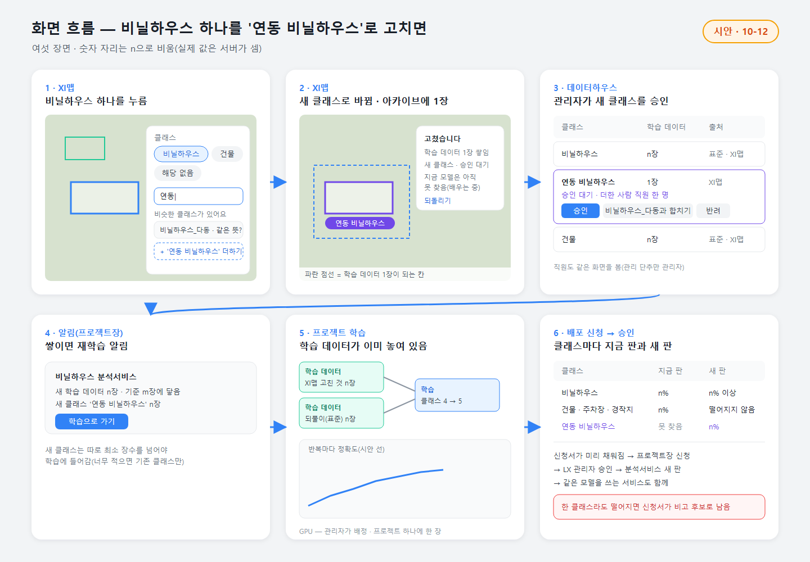

# 핵심 코어 — XI맵 · 데이터하우스 · 분석서비스 한 몸 · 심층 설계 (설계 23차 · 원칙 205 · 코어 C1 · C5 · C2)

> 사용자(10-12, 원칙 205): "어떤 분류인가요? 가 아니라. 클래스를 선택할 수 있도록. 필요시 추가 할 수 있도록. 이건 학습데이터 아카이브도 되는 부분. 재학습 처리하면 분석서비스 AI 모델이 재학습 되는 분석서비스-XI 맵-데이터하우스 모두 연동되는 핵심 코어 부분이 있다. XI 맵이 결국 코어이긴 하지."
> 이 문서는 설계와 검토 자료다. 코드 수정 0 · GPU 0 · 확인 페이지 만들지 않음. 서버 DB 는 읽기만(10-12). 그림 둘은 새로 그린 시안(`flow-core-loop` · `flow-screens` · '시안' 표시).
> 이어받는 것: 설계 17차 진화 틀(뒷면 한 바퀴 · 막는 자리 · 위험) · 설계 12차 학습 데이터 자산(클래스 층 · 표준/자유 · 흡수) · 설계 21차 학습 작업 흐름 · 구현 18(0037 고치기 기록). 함께 묶는 이미 정한 것: 원칙 131 · 133 · 136 · 152 · 182 · 196 · 198 · 200 · 203 · 208 · 209 · 질문 9 ⓑ · 11 ⓐ · 12 ⓐ · 13 · 자산-1 ⓐ(표준에만 클래스 층) · 자산-3 ⓐ(수시) · 조합 ⓑ(빠진 클래스는 무시) · 모델-재학습 ⓑ.

---

## 1. 한 장 구조

| # | 단계 | 무엇이 일어나나 | 누가 | 남는 것 |
|---|---|---|---|---|
| 1 | **클래스 고르기** | XI맵에서 객체를 누르면 그 자리 칸에 **그 분석서비스의 클래스 표**가 칩으로 뜬다(지금 찾는 것 · 배우는 중 · 같은 모델의 다른 클래스 · 해당 없음). 묻지 않고 고른다 | LX 직원 · 관리자 | 고치기 기록(0037) + 클래스 id |
| 1′ | **새 클래스 더하기** | 칩 아래 찾기 칸에 적으면 비슷한 클래스가 먼저 뜬다(이름 · 다른 이름 · 세부). 없으면 '+ 더하기' → 그 객체는 바로 새 클래스로 바뀌고 새 클래스는 **승인 대기 · 배우는 중** | 결정 1(추천: 직원이 더하고 관리자가 승인) | 클래스 목록 한 줄(proposed) |
| 2 | **학습 데이터 1장** | 고친 자리 둘레 한 칸(모델이 한 번에 본 칸)이 조용한 시간 뒤 저절로 학습 데이터 1장이 된다 — **'다 봤음' 단추 없음**(원칙 203 · 결정 3) | 저절로 | 라벨 칸 · 칸 그림 |
| 3 | **데이터하우스에 쌓임** | 그 칸이 클래스 층(XI맵 고친 것)에 들어가 장수 · 출처 · 판이 바뀐다 | 저절로 · 관리자 관리 | 클래스 층 · 아카이브 판 |
| 4 | **재학습 알림** | 한 서비스의 새 학습 데이터가 기준(제안 200장)에 닿으면 그 프로젝트장 요청함에 한 줄 | 결정 4(추천: 알림 → 사람이 누름) | 알림 |
| 5 | **학습 → 비교** | 프로젝트 학습 화면(원칙 200 · 208)에 '새 학습 데이터' 블록이 이미 놓여 있다. GPU는 관리자가 배정한 한 장 · 밤. 끝나면 같은 검증 묶음으로 클래스마다 지금 판과 견준다 — **막는 자리** | 프로젝트장 → 서버 | 재학습 묶음(잠금) · 새 모델 판(후보) · 비교 기록 |
| 6 | **배포 신청 → 승인** | 나아졌으면 신청서가 미리 채워진다(클래스별 값 · 새 학습 데이터 장수 · 고친 사람 · 시군구 수). 같은 모델을 쓰는 서비스는 한 신청서에 줄로. 신청은 프로젝트장 · 승인은 관리자(원칙 152) | 사람 | 승인 기록 · 서비스 새 판 · 클래스 표 새 판 |
| 7 | **XI맵 새 판** | 공유 기관에 새 판 알림 · XI맵 결과는 밤에 새 판으로 다시 분석(지난 판 결과는 이력) | 저절로 · 밤 · 낮은 순위 | 결과 판 꼬리표 · 계보 |

**세 화면이 함께 보는 기준 셋(한 곳에 두고 세 화면이 같은 값을 읽는다):**
| 기준 | XI맵 | 데이터하우스 | 분석서비스 |
|---|---|---|---|
| **클래스 표**(서비스마다 · 판마다) | 고치기 칩 · 범례 | 클래스 한 줄 = 한 클래스 | 카드 '찾는 것' · '배우는 중' 한 줄 |
| **학습 데이터 아카이브**(클래스 층 · 판) | '고쳤습니다 — 학습 데이터 1장' | 장수 · 출처 · 판 · 내려받기 | 신청서 '새 학습 데이터 n장' |
| **모델 계보** | 객체 칸 '모델 판' | 이 클래스를 쓴 모델 판 | 카드 '이번 판' 한 줄 |

**XI맵이 코어인 까닭(사용자 말 "XI 맵이 결국 코어"):** 학습 데이터가 새로 생기는 곳(고치기)과 새 판이 맨 먼저 보이는 곳(전국 결과)이 둘 다 XI맵이다. 데이터하우스는 쌓이는 곳, 분석서비스는 나가는 곳. 바퀴는 XI맵에서 시작해 XI맵으로 돌아온다.

---

## 2. 클래스 고르기 · 더하기 — 그 자리 칸

### 2-1. 칩에 무엇이 뜨나(지금 '분류 바꾸기'를 고침)
지금(구현 18): 고르기 목록 = 그 결과를 낸 **모델의 분류 글자**(없으면 결과에 나온 분류). 서비스가 무엇을 찾는지, 새 클래스가 무엇인지 모른다.

바뀜 — 그 객체가 속한 분석서비스의 **클래스 표**에서:
| 칩 줄 | 무엇 | 예(비닐하우스 분석서비스 · 항공 4분류 모델) |
|---|---|---|
| 지금 찾는 것 | 클래스 표 finds | 비닐하우스 |
| 배우는 중 | 클래스 표 learning(보라 점선 테두리) | (연동 비닐하우스 — 더한 뒤) |
| 같은 모델의 다른 클래스 | 같은 모델을 쓰는 다른 서비스의 클래스 — 고르면 그 서비스 학습 데이터로 감 | 건물 · 주차장 · 경작지 |
| 해당 없음 | 이 서비스가 찾는 것이 아님(학습에서 '여기엔 없다') | — |
| 찾기 · 더하기 | 적으면 클래스 목록에서 이름 · 다른 이름 · 세부 · 비슷한 글자를 먼저 보여 줌 → 없으면 '+ ○○ 더하기' | '연동' → '비닐하우스_다동 · 같은 뜻?' / '+ 연동 비닐하우스 더하기' |

화면 글은 칩과 찾기 칸뿐 — 질문 문장('어떤 분류인가요?')은 없앤다.

### 2-2. 새 클래스를 더하면
1. 그 객체는 **바로** 새 클래스로 바뀌고(되돌리기 가능), 지도에 보라 테두리 + 이름표. 칸에 '고쳤습니다 · 학습 데이터 1장 · 새 클래스 승인 대기 · 지금 모델은 아직 못 찾음'.
2. 새 클래스의 **상위**는 고치던 객체의 클래스로 저절로 채운다(비닐하우스를 고쳐 더했으면 '비닐하우스의 세부'). 직원에게 묻지 않고, 관리자가 승인할 때 바꿀 수 있다.
3. 관리자는 데이터하우스에서 **승인 · 다른 클래스와 합치기 · 반려** 중 하나. 합치면 그동안 그 이름으로 고친 것이 모두 합친 클래스로 옮겨 간다(기록은 남음). 반려면 그 객체들은 '해당 없음 + 메모'로 남고 학습에는 안 들어간다.
4. 승인되면 그 서비스 클래스 표에 **배우는 중**으로 들어간다(표 새 판).

### 2-3. 새 클래스를 더하면 기존 모델에 무슨 일이 생기나 — 화면에 어떻게
- **모델은 그대로다.** 모델은 학습 때 정해진 클래스만 낸다(항공 4분류 모델은 넷). 새 클래스는 **재학습 전까지 모델이 찾지 못한다** — 지도에 보이는 새 클래스 도형은 사람이 고친 것뿐.
- 그래서 화면 셋이 같은 말을 한다:
  | 화면 | 표시 |
  |---|---|
  | XI맵 | 칩 · 범례에 보라 점선 '배우는 중'. 새 클래스 도형 = 사람이 고친 것(이름표에 '고침') |
  | 데이터하우스 | 그 클래스 줄 '배우는 중 · 학습 데이터 n장 · 학습에 넣으려면 m장(제안 100)' |
  | 분석서비스(LX 직원 · 관리자 카드만) | '찾는 것: 비닐하우스' 아래 작게 '배우는 중: 연동 비닐하우스 · 학습 데이터 n장'. **기관 화면에는 0** — 기관에게는 새 판이 승인된 뒤에야 '찾는 것'에 나타난다 |
- **숫자 한 출처**: 새 클래스가 세부면(연동 ⊂ 비닐하우스) 서비스 합계는 상위 + 세부를 함께 센다 — 고쳤다고 '비닐하우스 n개'가 줄어들지 않는다.

### 2-4. 새 클래스를 모델에 넣는 두 길(결정 5)
| 새 클래스의 종류 | 넣는 길 | 왜 |
|---|---|---|
| **세부**(연동 비닐하우스 ⊂ 비닐하우스) | **세부 나누기** — 탐지 모델은 그대로 두고, 탐지된 비닐하우스 도형을 잘라 낸 그림을 '단동 · 연동'으로 나누는 작은 모델을 붙인다 | 표준 학습 데이터의 비닐하우스 90,264장에는 연동 · 단동 표시가 없다. 탐지 모델 하나에 넣으면 같은 하우스가 어떤 그림에선 '비닐하우스', 어떤 그림에선 '연동'으로 배워져 서로 싸운다. 세부 나누기는 고친 것 몇백 장 + 남원 드론 단동 2,138 · 다동 996개로 금방 배우고, 같은 모델을 쓰는 서비스 넷(건축물 · 주차장 · 비닐하우스 · 경작·휴경)을 흔들지 않는다 |
| **새 물체**(예: 태양광 — 지금 모델에 없는 것) | **모델 클래스 늘리기** — 기존 가중치를 이어받고 모델 머리를 4 → 5로. 기존 클래스 되풀이 자료 필수 | 새 물체는 탐지부터 해야 한다. 같은 모델을 쓰는 서비스 전부가 비교 · 신청에 함께 들어간다(2-5) |

### 2-5. 같은 모델을 쓰는 서비스(지금 넷)
- 클래스 늘리기나 고친 것 재학습은 **모델 하나에 한 번** — 대표 서비스(고친 것이 가장 많은 서비스)의 프로젝트에서 돈다.
- 비교는 넷의 클래스를 모두 잰다. **하나라도 떨어지면 신청서가 안 채워진다.**
- 나아졌으면 **한 신청서에 서비스 넷이 줄로** — 관리자는 한 번에 보고 승인. 숫자 한 출처 · 모델 한 계보 · 전국 다시 분석도 한 번(GPU 한 번).

---

## 3. 데이터하우스

### 3-1. 정의
**데이터하우스 = 학습 데이터 아카이브.** 한 줄 = 한 클래스. 원칙 131(학습 데이터 자산 — 목록 · 출처 · 라벨 · 수량 · 이용 조건 · 어느 모델에 쓰였나 · 판)과 원칙 133(관리자가 관리하는 공유 데이터 · 플랫폼 안 재사용 · 내려받기는 관리자 승인)을 담는 화면이고, 질문 11 ⓐ(서버 · 전부 등록부터)로 만들기로 한 자산 표가 바탕이다. **XI맵에서 고친 것이 들어오는 곳**이라 세 화면 중 하나가 된다.

### 3-2. 지금 메뉴 '데이터'와의 관계(결정 2)
지금 LX 직원 메뉴의 '데이터' = 데이터 올리기(지역별 영상 · 행정 자료가 갖춰졌나). 학습 데이터 화면은 직원 · 관리자 어디에도 없다.

| | ⓐ 추천 — '데이터' 자리를 '데이터하우스'로 | ⓑ '데이터'는 그대로 · 데이터하우스는 관리자 화면에만 |
|---|---|---|
| 이름 · 자리 | 왼쪽 메뉴 같은 칸(XI맵 아래)의 이름만 '데이터하우스'. 안에 두 탭: **학습 데이터**(첫 탭) · **영상 · 행정 자료**(지금 데이터 올리기 그대로) | 관리자 화면 '공유 데이터 › 학습 데이터'(설계 12차 시안 자리). 직원은 프로젝트 안 '공유 데이터 불러오기'로만 |
| 직원 | 보기 · 내가 고친 것 · 프로젝트로 불러오기 · 내려받기 요청 | 프로젝트 안에서만 봄 |
| 관리자 | 같은 화면 + 관리 단추(새 클래스 결정 · 판 내기 · 흡수 · 빼기 · 내려받기 승인) | 관리자 화면에서 관리 |
| 세 화면 한 몸 | XI맵 → '학습 데이터 1장' 누르면 그 클래스 줄로 바로 | XI맵에서 고친 직원이 쌓인 곳을 못 봄 |
| 메뉴 수 | 그대로(이름만 바뀜) | 그대로 |

**추천 ⓐ** — 사용자가 데이터하우스를 XI맵 · 분석서비스와 나란히 세 화면으로 불렀고(원칙 205), 고친 직원이 '내 고친 것이 어디로 갔나'를 볼 수 있어야 바퀴가 체감된다. 관리는 여전히 관리자만(원칙 133). 자산-2 답("밖에 보일 필요가 있는지 확인")은 원칙 205가 더 늦은 말이라 ⓐ 쪽이다 — 그래도 사용자 결정으로 묻는다.

### 3-3. 무엇을 보여 주나
**첫 화면(학습 데이터 탭)** — 한 줄 = 한 클래스. 글은 이름과 숫자만.
| 칸 | 예 | 출처 |
|---|---|---|
| 클래스(세부는 들여 씀) | 비닐하우스 / └ 연동 비닐하우스 | 클래스 목록 |
| 학습 데이터 | n장 | 클래스 층 합(원칙 209 '학습 데이터 n장') |
| 출처별 막대 | 표준(AI 허브) · 올린 것(프로젝트) · XI맵 고친 것 · 기관 신고(AI 오류) | 클래스 층 kind |
| 판 | 2판 · 다음 판에 n장 쌓이는 중 | 아카이브 판 |
| 쓰는 서비스 | 비닐하우스 분석서비스 | 클래스 표 |
| 상태 | 찾음 · 배우는 중 · 승인 대기 | 클래스 표 · 클래스 목록 |
| 이용 조건 | 확인됨 · 확인 필요 | 클래스 층 |

맨 위 한 줄: '이번 주 XI맵에서 쌓인 학습 데이터 n장 · 고친 사람 n명'(제안 1). 승인 대기 클래스가 있으면 관리자에게만 맨 위 칸.

**한 클래스를 열면** — 왼쪽 지도(XI맵에서 고친 자리 점 · 누르면 XI맵 그 자리로) · 오른쪽 그림 몇 장(칸 그림 · 작게) · 출처별 장수 · 판 목록(판 · 장 수 · 바뀐 점 · 그 판으로 학습한 모델) · 이 클래스를 찾는 서비스 · 내려받기 요청 단추(직원) / 승인 단추(관리자).

**영상 · 행정 자료 탭** — 지금 데이터 올리기 화면 그대로(손대지 않음 · 원칙 199).

---

## 4. 데이터 모델 · 서버 기능
`data-tables.md` — 지금 센 값 · 새 표(클래스 목록 · 서비스 클래스 표 · 라벨 칸 고침 · 클래스 층 · 아카이브 판 · 재학습 묶음 두 열 · 비교 · 내려받기 · 설정) · 지금 표에 더하는 열(0037 고치기 기록 · 모델 계보 · 서비스 판) · 권한 · 서버 기능 재사용/고침/새로.

핵심만:
- **재사용**: 고치기 기록 0037(원래 모양 · 되돌리기 · 시험 표시) · 모델 기록(classes · train_log · 학습 데이터 연결) · 학습 어댑터('검증만' 모드 포함) · 작업 대기열 · 전력 임대 · 배포 신청서(서버 값 · 낮은 정확도 경고) · 승인 · 기관 공유 · 새 판 알림 · 배포본 계보 · 감사 기록.
- **새로**: 클래스 목록(이름 하나 · 다른 이름 · 상위 · 상태) · 서비스 클래스 표(서비스 × 판 · 찾음/배우는 중) · 클래스 층(질문 11 ⓐ 자산 표) · 아카이브 판(잠금) · 재학습 묶음 고정(클래스 표 · 모드) · 비교 기록 · 모델 계보 열 · 내려받기 요청.

---

## 5. 위험과 막기
| 위험 | 어떻게 막나 |
|---|---|
| **클래스 남발** | 더하기 전에 비슷한 클래스를 먼저 보여 줌(이름 · 다른 이름 · 세부 · 비슷한 글자 — '연동' → '비닐하우스_다동') · 승인 전에는 학습에 안 들어감 · 서비스당 승인 대기 상한(제안 3) · 관리자 합치기(기록 저절로 옮김) · 최소 장수(제안 100장) 못 넘으면 학습에서 그 클래스만 뺌 · 오래 안 쓰인 클래스는 '쉬는 클래스' 제안 |
| **잘못 고친 라벨** | 원래 모양 · 분류 보존(0037) · 되돌리기 · 조용한 시간(제안 30분) 뒤에야 학습 데이터 · 같은 칸을 두 사람이 다르게 고치면 '다툼' — 학습 제외 · 데이터하우스에서 관리자가 고친 것을 훑다가 틀린 것만 빼기(확인 단추 없음 — 원칙 203) · 비교에서 고친 곳 검증 쪽이 떨어지면 막힘 |
| **한 사람 편향** | 재학습 묶음에서 한 사람 몫 최대(제안 40%) · 묶음에 고친 사람 수 · 시군구 수가 적힘(신청서에도) · 기준 묶음이 전국 4권역이라 한 지역에만 맞춘 판은 거기서 떨어짐 |
| **검증 묶음 오염** | 기준 묶음(AI 허브 시험 칸 3,000장) 잠금 · 지문 · 고친 칸의 20%는 칸 자리로 정해 영원히 검증 쪽 · 재학습 묶음을 만들 때 검증 그림과 같은 이름 · 같은 자리를 저절로 뺌(서버 시험) |
| **나빠진 판 자동 승격** | 자동은 '신청서 채우기'까지 · 같은 모델을 쓰는 서비스의 클래스 중 하나라도 떨어지면 신청서를 비우고 후보로 남김(10-08 비닐하우스 91% → 87%가 실제 사례) · 사람이 그래도 신청하면 경고가 신청서 · 승인 화면에 그대로(질문 9 ⓑ) · 승인은 언제나 관리자 |
| **같은 모델 서비스가 함께 흔들림** | 세부는 세부 나누기로(탐지 모델 그대로 · 결정 5) · 클래스 늘리기는 넷 모두 비교 · 한 신청서 |
| **GPU 전력** | 학습 · 비교 · 다시 분석 모두 작업 대기열로만 · 한 번에 한 건 · 관리자가 배정한 GPU 한 장(1 프로젝트 1 GPU · 원칙 200) · 밤 시간 창 · 다른 장이 100 W를 넘으면 멈춤(이미 있음) · 메모리 한도 넘으면 배치 줄여 다시(10-08 건축물 멈춤 교훈) · 언어 모델은 건드리지 않음. 세부 나누기는 잘라 낸 작은 그림이라 가볍다 |
| **영상 저장(원칙 136)** | 고친 칸만 작은 그림 한 장(1,024px · 장당 약 0.2~0.4MB 추정)으로 보관 — 영상을 쌓는 것이 아니라 학습 데이터 자산. 브이월드 바탕에서 고친 칸은 같은 자리 국토지리정보원 연도판으로 받음(약관의 저장 제한) · 기관이 올린 영상의 칸은 기관 동의가 있어야 학습에 씀 · 칸 그림은 화면에서 영상으로 다시 내지 않음 · 내려받기는 관리자 승인. 17차 결정 '영상조각'(추천 ⓐ)이 그대로 유효 |
| **기관 섞임 · 기관 화면** | 고치기 · 칸은 결과 주인 기준 행 단위 보안(지금 결과와 같음) · 기관 화면에 '배우는 중' · 새 클래스 · 다른 기관 칸 0 |

---

## 6. 화면 흐름(사람 말) — 시안 그림 둘째

1. **XI맵에서 비닐하우스 하나를 누른다.** 그 자리 칸에 비닐하우스 분석서비스의 클래스가 칩으로 뜬다 — 비닐하우스(지금) · 건물 · 주차장 · 경작지(같은 모델) · 해당 없음. 보니 여러 동이 붙은 연동 하우스다. 찾기 칸에 '연동'을 적으면 '비닐하우스_다동 · 같은 뜻?'이 먼저 뜨고, 아래 '+ 연동 비닐하우스 더하기'.
2. **'연동 비닐하우스'를 더한다.** 객체가 보라 테두리 '연동 비닐하우스'로 바뀌고, 칸에 '고쳤습니다 · 학습 데이터 1장 · 새 클래스 승인 대기 · 지금 모델은 아직 못 찾음'. 둘레 파란 점선이 학습 데이터 1장이 되는 칸이다. 누르는 확인 단추는 없다.
3. **데이터하우스에 1장.** 데이터하우스 학습 데이터 탭에 '└ 연동 비닐하우스 · 1장 · XI맵 · 승인 대기'. 관리자는 그 줄에서 승인 · 비닐하우스_다동과 합치기 · 반려 중 하나를 누른다. 승인되면 비닐하우스 분석서비스 클래스 표에 '배우는 중'.
4. **쌓이면 재학습 알림.** 직원들이 여러 시군구에서 고쳐 비닐하우스 서비스의 새 학습 데이터가 기준(제안 200장)에 닿으면, 그 프로젝트장 요청함에 '비닐하우스 분석서비스 · 새 학습 데이터 n장 · 새 클래스 연동 비닐하우스 n장 → 학습으로 가기'. 연동이 최소 장수(제안 100장)를 못 넘었으면 '이번엔 기존 클래스만'.
5. **학습.** 프로젝트 학습 화면에 '학습 데이터 · XI맵 고친 것 n장'과 '되풀이 n장' 블록이 이미 이어져 있다. 누르면 밤에 관리자가 배정한 GPU 한 장으로 돌고, 반복마다 정확도 선이 차오른다(원칙 200 · 208 — 이 프로젝트 지금만).
6. **새 판 정확도 → 배포 신청.** 끝나면 같은 검증 묶음으로 클래스마다 '지금 판 · 새 판'. 비닐하우스 이상 · 건물 · 주차장 · 경작지 떨어지지 않음 · 연동 비닐하우스 새로 n%면 신청서가 미리 채워진다 → 프로젝트장 신청 → 관리자 승인 → 분석서비스 '찾는 것'에 연동 비닐하우스가 들어가고 공유 기관에 새 판 알림 → XI맵 결과는 밤에 새 판으로 다시 분석. 하나라도 떨어졌으면 신청서는 비고 후보로 남는다.

---

## 7. 구현 단계와 작업량(추정)
17차 1~3단(약 15일)을 이 설계로 대신한다 — 클래스 표 · 데이터하우스(0단)와 새 클래스 학습(세부 나누기 · 클래스 늘리기)이 더해졌다. 지금 고치기 기록(0037)과 XI맵 칸은 그대로 이어 쓴다.

| 단 | 무엇 | 완료 기준(바깥 주소 · 로그인 폼 · 실제 화면) | 작업량 |
|---|---|---|---|
| **0단 클래스 표 · 데이터하우스 바탕** | 클래스 목록 씨앗(모델 21 · 표준 30 · 서비스 찾는 것 → 이름 하나 · 다른 이름 · 세부) · 서비스 클래스 표(지금 서비스 판에서) · 클래스 층 등록(디스크 68층 · 이용 조건 첫 값) · 데이터하우스 학습 데이터 탭(보기 · 한 클래스 열기) · 메뉴 이름(결정 2) | 데이터하우스 첫 화면 클래스 줄의 장수가 서버 셈과 같음 · 분석서비스 카드 '찾는 것'이 클래스 표와 같음(숫자 자동 대조) | 서버 3일 · 화면 2일 ≈ **5일** |
| **1단 고르기 · 더하기 · 쌓기** | XI맵 칩(클래스 표) · 찾기 · 더하기 · 관리자 결정(승인 · 합치기 · 반려) · 고치기에 클래스 id · 칸 저절로(조용한 시간 · 칸 그림 CPU) · 데이터하우스에 장수 · '배우는 중' 세 화면 표시 · 기관 화면 0 | 두 시군구에서 고르기 · 더하기 → 승인 → 데이터하우스 장수가 바로 · 되돌리면 줄어듦 · 합치면 옮겨 감 · 기관 계정에 새 클래스 0 | 서버 3일 · 화면 2.5일 · 실증 0.5일 ≈ **6일** |
| **2단 재학습 · 비교** | 재학습 알림 · 재학습 묶음 고정(아카이브 판 잠금 · 되풀이 · 한 사람 몫 · 검증 겹침 0) · 어댑터 여러 묶음 · 클래스 늘리기 · 세부 나누기 · 밤 창 · 서버 비교 판정(같은 모델 서비스 모두) | 시험 서비스 하나: 알림 → 누름 → 밤 학습(두 장 동시 고부하 0 — 전력 기록) → 클래스별 비교 숫자가 학습 화면 · 신청서 · 승인 화면에서 같음 · 나빠진 판은 신청서 비어 있음 | 서버 5일 · 화면 1일 · GPU 밤 2회 ≈ **6일 + 밤 2** |
| **3단 새 판 연계** | 신청서 미리 채움(같은 모델 서비스 한 장) · 승인 → 클래스 표 새 판 · 기관 알림 · XI맵 밤 다시 분석 · 계보 한 줄(세 화면) | XI맵에서 고침 → … → XI맵에 새 판 결과까지 한 바퀴 영상 한 편 · 같은 숫자가 세 화면에서 같음 | **4일** |
| 합 | | | **약 21일 + GPU 밤 2~3회** |

동시 작업 2~3개 규칙 · 0단과 지금 XI맵 그리기 고침(다른 오퍼스)은 서로 다른 파일이라 나란히 갈 수 있다. 학습 작업 흐름(21차) 화면이 먼저 생기면 2단은 그 블록을 쓰고, 아니면 프로젝트 학습 화면에 '학습으로 가기' 단추 하나로 시작한다.

---

## 8. 결정해 주실 것(다섯)
| # | 물음 | ⓐ | ⓑ | 추천 · 근거 |
|---|---|---|---|---|
| 1 | **새 클래스는 누가 더하나** | LX 직원이 XI맵 그 자리에서 더함 → 바로 그 객체에 씀 → 관리자가 데이터하우스에서 승인 · 합치기 · 반려(승인 전엔 학습 안 들어감) | 관리자만 더함 — 직원은 '새 클래스 요청' · 그 사이 객체는 '해당 없음 + 메모' | **ⓐ** — 사용자 말 "필요시 추가할 수 있도록"은 그 자리에서 막히지 않는 것. 남발은 비슷한 클래스 먼저 보이기 · 승인 대기 상한 · 승인 전 학습 제외로 막는다. ⓑ는 고친 순간의 판단이 메모로 흩어져 다시 고쳐야 함 |
| 2 | **데이터하우스 이름 · 자리** | 직원 메뉴 '데이터' 자리를 '데이터하우스'로 · 탭 둘(학습 데이터 첫 탭 · 영상 · 행정 자료 = 지금 화면 그대로) · 관리 단추는 관리자만 | '데이터'는 그대로 · 데이터하우스는 관리자 화면 '공유 데이터' 안에만 · 직원은 프로젝트 안 불러오기 | **ⓐ** — 원칙 205가 세 화면을 나란히 부름 · 고친 직원이 쌓인 곳을 봐야 바퀴가 체감됨 · 메뉴 수 그대로 · 관리는 원칙 133 그대로 |
| 3 | **학습 데이터 1장이 되는 때** | 고치면 저절로 — 고친 자리 둘레 한 칸이 조용한 시간(제안 30분) 뒤 학습 데이터 1장 · 누르는 단추 없음 | 칸 '다 봤음'을 눌러야 1장(17차 안) | **ⓐ** — 원칙 203('봤음' 같은 확인 기록은 남기지 않는다)과 맞음. 잘못 고친 것은 되돌리기 · 다툼 제외 · 검증 쪽 비교로 막음. 17차 결정 '라벨단위'를 이것으로 대신 |
| 4 | **재학습 시작 조건** | 새 학습 데이터가 기준(제안 200장)에 닿으면 프로젝트장에게 알림 → 사람이 누름 → 밤에 돎 | 기준에 닿으면 밤에 저절로 시작(신청 · 승인은 사람) | **ⓐ** — 원칙 51(프로젝트장 판단) · GPU는 관리자 영역이라 처음엔 사람이 보며 쓴다. 설정 하나로 나중에 ⓑ로. 17차 결정 '다시학습'을 이것으로 대신 |
| 5 | **새 클래스를 모델에 넣는 법** | 둘로 나눔 — 세부(연동 ⊂ 비닐하우스)는 '세부 나누기'를 붙이고 탐지 모델은 그대로 · 새 물체(태양광 등)만 모델 클래스를 늘림 | 언제나 모델 클래스를 늘림(모델 하나) | **ⓐ** — 표준 비닐하우스 90,264장에 연동 · 단동 표시가 없어 한 모델에 넣으면 서로 싸움. 지금 모델 하나를 서비스 넷이 함께 써서 ⓑ는 넷을 매번 흔든다. 세부 나누기는 가볍고(GPU 짧음) 남원 드론 단동 2,138 · 다동 996개로 바로 시작할 수 있다 |

17차의 나머지 결정: '영상조각'(추천 ⓐ 칸 그림 보관) · '나아짐기준'(추천 ⓐ 기준 묶음 유지 + 고친 곳 나아짐)은 그대로 유효(다시 묻지 않음) · '결과확인'은 원칙 198 · 203(결과 확인 = 지도에서 보고 고치기)으로 이미 풀림.

---

## 먼저 드리는 제안(원칙 57)
1. **데이터하우스 맨 위 '이번 주 XI맵에서 쌓인 학습 데이터 n장 · 고친 사람 n명'** — 누가 왜: LX 관리자 · 프로젝트장. 코어가 돌고 있다는 것이 숫자 하나로 보이고, 아무도 안 고치는 주를 바로 안다.
2. **재학습 판은 승인 한 번** — 누가 왜: 프로젝트장 · LX 관리자. 지금은 같은 판에 '모델 등록 결정'과 '배포 승인' 두 번을 거친다. 서버 비교를 통과한 재학습 판은 배포 신청서 한 장(비교 값이 붙은)으로 등록 · 공개를 함께 결정하면 바퀴가 하루 줄어든다.
3. **XI ChatGEO 로 아카이브 묻기** — 누가 왜: LX 직원 · 관리자. "연동 비닐하우스 학습 데이터 몇 장?" · "지난주 어디서 많이 고쳤어?"에 데이터하우스와 같은 숫자로 답하고 지도로 날아감(C2 vLLM 서비스 · 같은 출처).

## 파일
- `README.md` 한 장 · `data-tables.md` · `items.json`(now 용 — 코어 구조 + 결정 다섯)
- 그림(새로 그림 · '시안' 10-12): `flow-core-loop.svg/.png`(한 바퀴 · 세 화면 · 기준 셋) · `flow-screens.svg/.png`(여섯 장면)
