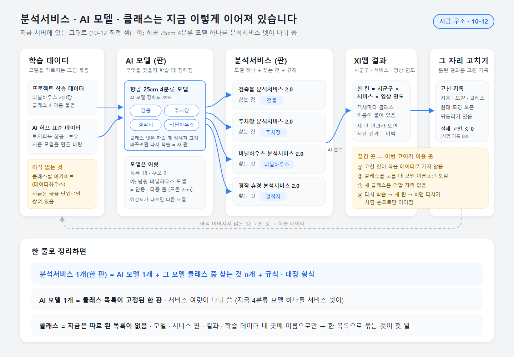
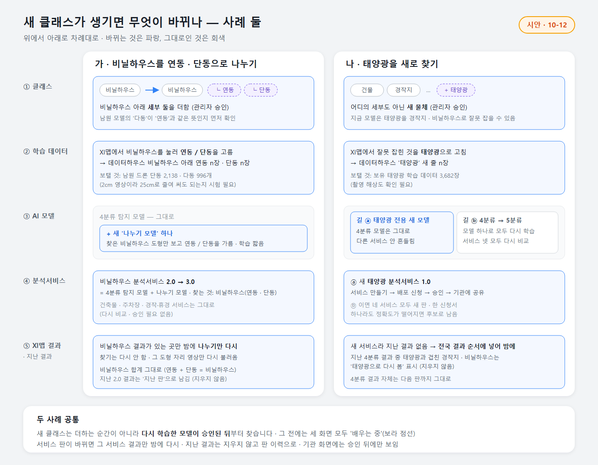
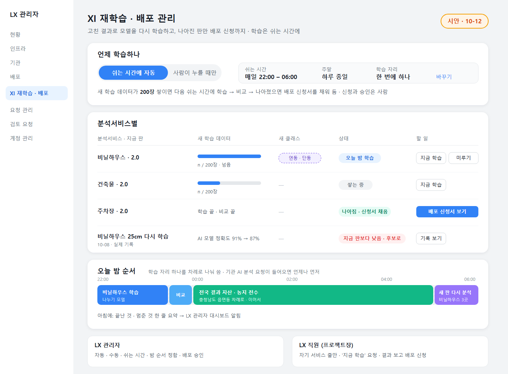
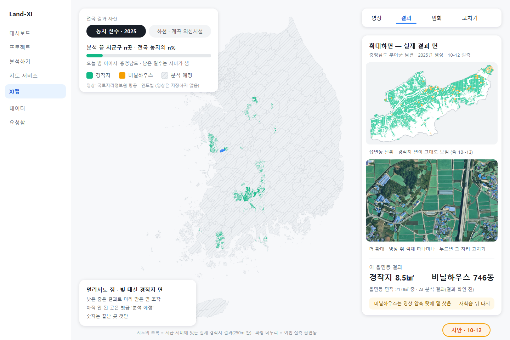

# 설계 24차 · 코어 구조 다시 보기 + 전국 결과 자산 (원칙 205 · 211 · 213 · 136)

브리핑 확인: (1) **확인받고 만든다** — 이번은 조사 · 설계 · 실측만. 화면 · 서버 코드 수정 0, 확인 페이지 안 만듦(now 용 items.json 만). (2) **GPU 한 장 · 작업 대기열로만** — 실측은 읍면동 하나(부여군 남면)만 대기열 · 낮은 순위 · 시험 표시로, 전국은 돌리지 않음. (3) **숫자 한 출처 · 지어낸 숫자 0** — 숫자는 10-12 서버에서 직접 센 값 · 이번 실측 · 공개 통계(출처 적음). 추정은 '추정'으로 표시.

> 사용자(10-12 11:26): 코어 구조 "맞음" · 결정 1 "분석서비스-XI맵-학습데이터 아카이브 구조를 파악해서 새 클래스 추가 및 재학습 개선 모델에 대한 부분을 좀 더 검토" · 결정 5 "클래스와 AI 모델 관계에 대해 해깔린다" · 결정 4 "자원 유휴 시간대. 혹은 수동을 선택하는 XI 재학습-배포 관리 기능이 필요" · XI맵 "그냥 전국 경작지를 보여주던가 … 전국단위 분석을 해서 결과 자산을 확보해라. 농지 전수조사, 하천계곡 의심시설 실태조사 등"

## 가. 구조 — 한 장

- **분석서비스 1개(한 판) = AI 모델 1개 + 그 모델 클래스 중 찾는 것 n개 + 규칙 · 대장 형식.**
- **AI 모델 1개 = 클래스 목록이 고정된 한 판.** 여러 서비스가 나눠 씁니다 — 지금 '항공 25cm 4분류 모델'(건물 · 주차장 · 경작지 · 비닐하우스) 하나를 건축물 · 주차장 · 비닐하우스 · 경작·휴경 서비스 넷이 씁니다.
- **클래스는 지금 따로 된 목록이 없습니다** — 모델 · 서비스 판 · 결과 · 학습 데이터 네 곳에 이름으로만. 고친 기록은 60줄 모두 시험(실제 0)이고, 고친 것이 학습 데이터로 가는 길이 아직 없습니다.

## 나. 새 클래스가 생기면 — 사례 둘

| | 가 · 비닐하우스 → 연동 · 단동 (세부) | 나 · 태양광 (새 물체) |
|---|---|---|
| AI 모델 | 4분류 모델 그대로 + 작은 '나누기 모델' | ⓐ 전용 새 모델 · ⓑ 4분류 → 5분류 |
| 분석서비스 | 비닐하우스만 2.0 → 3.0 · 다른 셋 그대로 | ⓐ 새 '태양광 분석서비스' · ⓑ 넷 모두 새 판 |
| XI맵 결과 | 비닐하우스 있는 곳만 밤에 나누기 · 합계 그대로 | 지난 결과 없음 → 전국 결과 순서에 넣음 |
| 지난 결과 | 지우지 않고 '지난 판' | 겹친 경작지 · 비닐하우스에 '태양광으로 다시 봄' 표시 |

새 클래스는 **다시 학습한 모델이 승인된 뒤**부터 찾습니다. 그 전에는 세 화면 모두 '배우는 중'.

## 다. XI 재학습 · 배포 관리 (결정 4 · 시안)

LX 관리자 '배포' 아래 한 메뉴. **언제 학습하나**(쉬는 시간 자동 / 사람이 누를 때만 · 쉬는 시간 22–06 · 주말) → **분석서비스별 줄**(새 학습 데이터 n/200 · 새 클래스 · 상태 · 할 일) → **오늘 밤 순서**(학습 · 비교 · 전국 결과 · 새 판 다시 분석이 학습 자리 하나를 나눠 씀). LX 직원(프로젝트장)은 자기 서비스 줄만 보고 '지금 학습' 요청 · 배포 신청. 자동이어도 신청 · 승인은 사람.

## 라. 전국 결과 자산 — 실측과 일정
**실측(충남 부여군 남면 20.97㎢ · 2025년 영상 · 영상 파일 쌓지 않음 · GPU 한 장)**: 영상 부르기 112초 · AI 분석 118초 → **1㎢ 약 6초**. 결과 경작지 3,969곳(8.5㎢) · 비닐하우스 746동. 결과 크기 1㎢ 약 0.5MB(지도 조각 + 결과 장부).

| 범위 | 이어 돌리면 | 밤만 | 결과(한 해) |
|---|---|---|---|
| 농지 둘레(약 3.1만㎢ · 추정) | 약 2일 | **약 6일** | 약 15GB |
| 국토 전체(100,460㎢) | 약 6.5일 | 약 20일 | 최대 약 49GB |
| 하천 띠(국가 · 지방 양쪽 100m · 약 6,000㎢) | 약 9시간 | 밤 1~2번 | 약 3GB |

⚠ 영상 호출량 한도를 정식으로 확인하기 전 값입니다 — 한도가 낮으면 날수가 늘어납니다. 자세히 `national-plan.md`.

**모델**: 경작지 · 건물 · 비닐하우스는 지금 모델로 됩니다(비닐하우스는 재학습 뒤가 좋음). **휴경**은 모델이 없어 두 해 비교로 '휴경 의심'부터. **평상 · 그늘막 · 데크**(하천 · 계곡 적발의 약 4분의 1)는 모델이 없고, 보유 '아산 하천부지 점유현황'(드론 2cm) · '수변구역 변화 탐지'(항공 25cm) 데이터 + 25cm에서 보이는지 시험이 먼저입니다.

XI맵: 끝난 곳은 **실제 경작지 면**(멀리서도 면 조각 · 확대하면 영상 위 객체), 안 된 곳은 빗금 '분석 예정'. 시안 지도의 초록은 지금 서버에 있는 실제 결과입니다.

## 묻고 싶은 것 (items.json — 12개)
1. 지금 구조 이해됨? · 결정 1 새 클래스 누가 · 결정 5 모델에 넣는 법 · 결정 4 자동 기본 / 수동 기본 · 결정 2 데이터하우스 자리 · 결정 3 학습 데이터 되는 때
2. 전국 결과 — XI맵 보이는 방식 · 무엇부터(농지 / 하천 · 계곡 / 둘 다) · 언제(밤만 / 낮에도 놀 때) · 순서(농지 많은 도 / 기관 있는 곳) · 휴경(해마다 비교 / 새 학습) · 하천 범위(국가 · 지방 띠 / 소하천 · 계곡까지)

## 먼저 드리는 제안
1. **농지 전수 결과로 '농지 이용 실태' 보고서 바로 내기** — 누가 왜: 지자체 농지 담당. 경작지 결과 × 연속지적 지목(전 · 답) = '농지인데 경작 흔적 없음 n필지'(휴경 의심)가 읍면동 표로 나오면, 매년 하는 농지 이용실태조사의 현장 확인 대상을 줄여 줍니다(코어 C3).
2. **하천 · 계곡은 '건물 · 경작'부터 지금 모델로** — 누가 왜: 행정안전부 · 시군구 하천 담당. 재조사 적발의 38%가 건축물 · 경작이라, 평상 모델을 기다리지 않고 하천 띠 × 건축물대장 대조만으로 첫 결과를 낼 수 있습니다.
3. **XI ChatGEO 로 진행 묻기** — 누가 왜: LX 관리자. "농지 전수 어디까지 했어?" · "전남 휴경 의심 몇 필지?"에 진행 장부 · 결과 장부와 같은 숫자로 답하고 지도로 날아감(C2).

## 파일
- `structure.png` · `cases.png` · `retrain-admin.png` · `ximap-national.png` (원본 `.svg` · 시안 표시)
- `img/real-closeup.jpg` · `img/real-emd-faces.png` (실측 실제 결과) · `img/nat-map.png` (지금 서버의 실제 경작지 결과 전국 그림)
- `national-plan.md` (실측 표 · 일정 · 범위 · 숫자 출처) · `code-map.md` (구현하는 사람용 표 · 경로) · `items.json` (now 용 12개)
