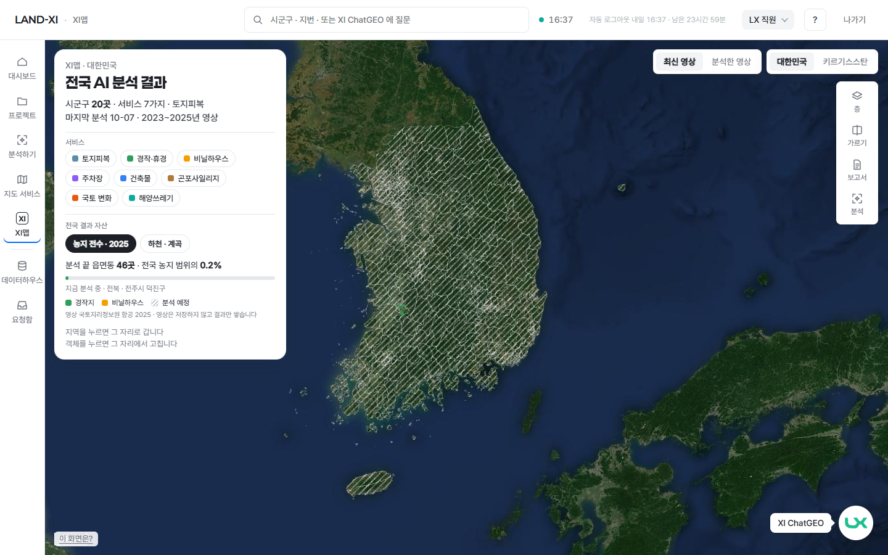
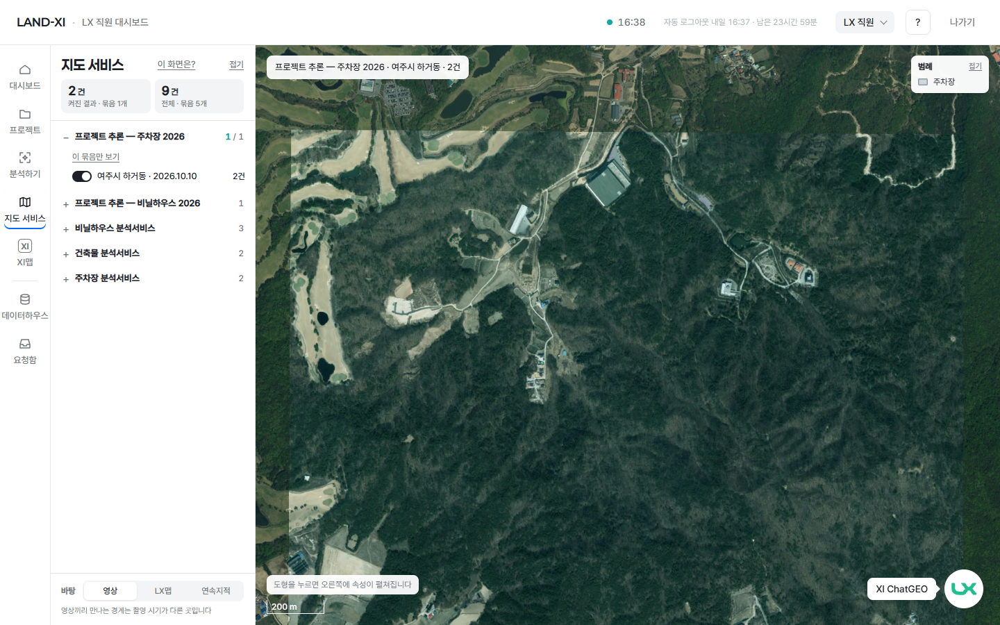

# 설계 26차 · XI맵 = 최종 퍼포먼스 맵 — 진단 + 방향 둘 시안 (원칙 227 · 229 · 182 · 196 · 204 · 211 · 218)

브리핑 확인: (1) **확인받고 만든다** — 진단 · 재료 확인 · 시안만. 실제 화면 · 서버 · 전국 작업기 수정 0, 확인 페이지 안 만듦(items.json 만). (2) **이미 쓰던 화면은 묻지 않고 바꾸지 않는다(원칙 199) · 왼쪽 직원 메뉴 그대로(원칙 196)** — 시안도 메뉴 레일은 그대로 두고 지도 판만 다르게. (3) **내부 지표 금지 · 숫자 한 출처** — 시안 숫자는 전부 서버에서 그 자리에서 읽은 값(못 읽으면 '—'), GPU · ms · 폴리곤 수 · 작업 id 0. 바깥 주소 로그인 폼(LX 직원)으로만 찍음 · 세션 주입 0 · 외부 요청에 메일 · 키 0.

> 사용자(10-12 16:18): "왼쪽 레이어? 층? 보면 의미가 없다. 지도 서비스랑 뭔 차이야? XI맵은 XI 맵의 특징과 혁신이 전혀 안보인다. ㅠㅠ" → 얼굴 넷(살아 있는 전국 분석 · 말로 다루는 지도 · 고치며 똑똑해지는 지도 · 시간을 넘나드는 지도) · "지도 서비스는 내 결과인거고, XI 맵은 이 시스템의 최종 퍼포먼스 맵이다."

## 1. 진단 — 지금 XI맵과 지도 서비스를 나란히 (바깥 주소 · LX 직원 · PC 1440 · 10-12 16:38)

| 지금 XI맵 | 지금 지도 서비스 |
|---|---|
|  |  |

1. **겹침:** XI맵 왼쪽 큰 카드(서비스 칩 8 · 결과 자산 · 범례 · 안내 두 줄)와 오른쪽 도구(층 · 가르기 · 보고서 · 분석)는 지도 서비스의 왼쪽 묶음 목록 · 범례 · 바탕 전환과 **같은 문법** — 둘 다 "층을 켜고 보는 지도"라 차이가 안 보입니다.
2. **가장 크게 보이는 것이 '아직 안 됨':** 국토 전체를 덮은 빗금 '분석 예정'이 첫인상이고, 실제 결과(전주 일대 초록)는 점 하나 크기.
3. **살아 있는 분석이 글 한 줄:** "지금 분석 중 · 전북 · 전주시 덕진구" 글자뿐 — 지도에서 아무것도 움직이지 않습니다.
4. **시간 · 진화가 숨어 있음:** 연도는 "2023~2025년 영상" 글자뿐이고 넘길 길이 없음. 고치기 → 재학습 → 새 판은 객체를 눌러야만 나옵니다.
5. **말로 다루는 지도가 구석 단추:** XI ChatGEO 는 오른쪽 아래 작은 단추 — 네 얼굴이 전부 글이거나 숨어 있고, 보이는 것은 지도 서비스와 같은 층 · 범례 · 도구입니다.

## 2. 실제로 쓸 수 있는 재료 (10-12 16:36~16:54 서버에서 직접 읽음 — 지어낸 숫자 0)

| 얼굴 | 지금 진짜 있는 재료 | 없는 재료(시안에서는 '시안' 표시 · 또는 '—') |
|---|---|---|
| **살아 있는 전국 분석** | 전국 작업기 진행 장부(끝난 읍면동 49곳 · 90.5㎢ · 경작지 14,801곳 · 비닐하우스 641동 · 전국 농지의 0.2% · 지금 분석 중인 읍면동 '전주시 덕진구 여의동' · 하루 예상 ㎢ · 남은 일수 · 작업기 '돌고 있음') · 끝난 칸 결과 묶음 위치 **67개** · 전국 결과 면 지도 조각(농지 전수 2025) · 읍면동 경계(37개 · 전주시 덕진구) · 찍는 동안 숫자가 14,291 → 14,801 로 **실제로 늘어남**(16:46 → 16:48) | '오늘' 끝난 칸 집계(끝난 시각은 있으나 하루 단위 집계 없음 → 시안은 '지금까지') · 칸 하나의 진행률(시작 · 끝 시각만) · 끝난 칸 알림(실시간 흐름에 전국 작업기 이벤트 없음 → 시안은 다시 읽기 가정) · 학습 장비 대기열은 LX 관리자 전용(직원은 '바쁨' 여부만) |
| **말로 다루는 지도** | XI ChatGEO 연결됨(vLLM · 두뇌 + 라우터 · 예비) · 되는 일: 필지로 이동 · 결과 층 켜기 · 결과 통계 · 실태조사 거르기 · 보고서 초안(.docx) · 분석 견적 · 실행 · 서랍 열기 | 전국 작업기 진행을 묻는 도구 · 시군구 **이름**으로 날아가기(지금은 필지 번호만) · 연도 바꾸기 · 두 해 비교 도구 → 시안의 세 질문은 **각본**(답 문구는 시안 · 숫자는 서버 값) |
| **고치며 똑똑해지는 지도** | 그 자리 고치기 기록(실제 0건 · 시험 60줄) · 비닐하우스 재학습 판정(**새 판 87% · 지금 판 91%** · 같은 검증 묶음 · 후보로 남음) · 학습 기록(학습 데이터 35,247장 · 20번 반복 · 10-08 끝) · 학습 데이터 묶음 5개 · 클래스 20개 · 재학습 설정(자동 · 22~06) | 고친 것 → 학습 데이터로 실제 이어진 건(0) · 새 판이 이긴 사례(없음 → '판이 바뀌는 순간'은 **예시 동작**) · 서비스별 새 판 이력 목록(0줄) |
| **시간을 넘나드는 지도** | 국토지리정보원 연도별 영상 2011~2025(키 없음 · 전국 작업기가 2025년 영상으로 돌고 있음) · 결과 연도: 2025 전국 진행 · 2023 시군구 20곳 · **남원 같은 자리 두 해**(2023 비닐하우스 703동 · 2025 경작지 2,098곳 — 둘 다 지도 조각 있음) | 화면용 연도별 영상 타일(지리원 타일은 좌표계가 달라 서버 변환이 필요 → 시안 바탕은 지금 영상 그대로) · 해마다 전국 결과(2025 한 해뿐) · 두 해 결과 차이(생김 · 없어짐) 계산 |

## 3. 방향 둘 — 한 주소에서 단추로 바꿔 보기

**시안 주소:** `https://app.land-xi.dev/landxi/proto/review/mock/ximap-perf/index.html` (`?v=a` · `?v=b` · LX 직원 로그인 · '시안' 도장 · 숫자는 서버 값)

공통 전제: 왼쪽 층 목록 없음(직원 메뉴 레일 그대로) · 지도 서비스 도구(층 · 범례 · 내려받기) 반복 없음 · 밝은 톤 · 지도 위 카드 ≤ 3장 · 생동감은 움직임(차오르는 칸 · 흐르는 결과 · 판이 바뀌는 순간) · 빗금 없음 · 배경 그대로(원칙 218).

### A안 · 라이브 지휘소 — 네 얼굴이 한 화면에 늘 함께, 지도가 주인공

- 열자마자 전국 **실제 경작지 면**(농지 전수 2025 지도 조각) · 끝난 읍면동은 은은히 · **지금 분석 중인 읍면동이 숨 쉬듯 차오름**(실제 경계) · 끝난 칸 67곳에서 **결과 고리가 차례로 흐름**.
- 왼쪽 위 사진 위 흰 글자: 큰 숫자 하나(지금까지 찾은 경작지) + 읍면동 · ㎢ + '지금 분석 중' 살아 있는 칩.
- 위 가운데 **연도 막대**(2011~2025 · 결과 있는 해 2023 · 2025 표시 · 누르면 결과가 바뀜).
- 아래 가운데 **XI ChatGEO 가 주인공** — 추천 질문 셋(전주 덕진구 경작지 · 남원 두 해 비교 · 오늘 어디까지) → 말이 타자되고 지도가 날아가고 답(서버 숫자)이 뜸.
- 오른쪽 아래 **진화 띠**: 고친 것 0건 → 학습 데이터 35,247장 → 다시 학습 20번 → 새 판 87% · 지금 91%(후보) → 기관에 공유. '판이 바뀌는 순간 보기'는 예시 동작(띠와 지도 면이 한 번 밝아지며 새 판이 켜짐).
- 영상 전환은 오른쪽 작은 단추(최신 영상 · 분석한 영상)만.
- 10초 녹화: `shots/mock-a-10s-1652.mp4` (흐르는 결과 → "남원 2023과 2025 비교해 줘" → 두 해가 바뀜 → 판이 바뀌는 순간)

### B안 · 이야기로 보는 아카이브 — 네 장면을 위 탭으로 넘기되 모두 같은 지도 위

- 위 가운데 탭 넷 = 얼굴 넷. 장면마다 지도 위에는 한 가지만(HUD + 카드 1장).
- 1 살아 있는 전국 분석(전국 · 차오르는 칸 · 흐르는 결과) → 2 시간(남원으로 날아가 **2023 ↔ 2025 실제 결과**가 바뀌고 큰 연도 막대) → 3 진화(가로 띠 다섯 칸 · 87% vs 91%) → 4 말로(ChatGEO 가 화면 가운데 넓게).
- 10초 녹화: `shots/mock-b-10s-1657.mp4` (장면 1 → 2 → 3 '판이 바뀌는 순간' → 4 질문)

## 4. 안마다 — 사라지는 것 · 새로 필요한 서버 재료 · 구현 크기

| | A안 라이브 지휘소 | B안 이야기로 보는 아카이브 |
|---|---|---|
| **사라지는 것**(지금 XI맵에서) | 왼쪽 큰 카드(서비스 칩 8 · 결과 자산 · 범례 글 · 안내) · 빗금 '분석 예정' · 오른쪽 도구 중 '층'(연도 막대 · 말로 대신) · '가르기'(두 해 비교로) · 시군구 20곳 카드 · 나라 전환 단추(해외는 ChatGEO · 검색으로) | A와 같음 + 네 얼굴을 한 화면에 두지 않으므로 지도 위 카드 1장 |
| **새로 필요한 서버 재료**(없는 것만) | ① 전국 작업기 진행 알림(끝난 칸 · 지금 칸 — 실시간 흐름 또는 5초 다시 읽기) ② 지리원 연도별 영상 화면 타일(좌표계 변환 프록시) ③ ChatGEO 도구 셋(전국 진행 묻기 · 시군구 이름으로 이동 · 연도 바꾸기 · 두 해 비교) ④ 고친 것 → 학습 데이터 → 새 판 이력 한 줄 조회(지금은 세 API 를 합쳐야 함) | ①~④ 같음. 장면 1 · 2 를 먼저 내고 ③ 은 장면 4 때 — 나눠 낼 수 있음 |
| **구현 크기** | **큼**(화면 보통 + 서버 보통 — ①②③ 셋 다 있어야 얼굴 넷이 움직임) | **보통**(장면마다 한 가지 · 단계별로 낼 수 있음) |

**추천: A안.** 사용자 말대로 XI맵은 "개인과 상관없이 Land-XI 는 이런 시스템이다"를 한눈에 보여 주는 자리라, 네 얼굴이 늘 함께 보이고 지도 자체가 움직여야 합니다. B안의 탭은 또 하나의 '메뉴'가 되어 얼굴을 숨깁니다(눌러야 보임 — 왼쪽 층 목록과 같은 문제). 다만 B안의 장면 2(두 해 비교) · 3(진화 띠 가로)은 A안 안에서 ChatGEO 가 대답할 때 잠깐 펼치는 모습으로 가져오면 좋습니다.

## 먼저 드리는 제안
1. **전국 작업기 알림을 실시간 흐름에 붙이기** — 누가 왜: LX 직원 · 관리자 모두. 지금 끝난 칸이 지도에서 바로 밝아져야 '살아 있는 분석'이 글이 아니라 체감이 됩니다(지금은 장부를 다시 읽어야 함).
2. **ChatGEO 에 '전국 진행 · 지역 이름 · 연도' 도구 셋** — 누가 왜: 기관 담당자도 "우리 군 경작지 2025 보여줘"로 바로 가야 말로 다루는 지도가 됩니다(지금은 필지 번호만).
3. **지리원 연도별 영상 화면 타일 프록시** — 누가 왜: 시간을 넘나드는 지도의 바탕. 영상은 저장하지 않고 그때 변환해 내보내면 됩니다(원칙 136).

## 파일
- `diag-ximap-1440-1638.png` · `diag-mapsvc-1440-1639.png` · `log-diag.json` — 진단 캡처(바깥 주소 · LX 직원 로그인 폼 · 1440×900)
- `shots/mock-a-*.png` · `shots/mock-b-*.png` · `shots/mock-a-10s-*.mp4` · `shots/mock-b-10s-*.mp4` · `log-mock.json` · `log-video.json` — 시안 캡처 · 10초 녹화(shots/ 는 저장소 밖 — now 굽기용 로컬)
- `shoot-diag.py` · `shoot-mock.py` — 다시 찍기(로그인 폼 · server/.env DEV_PASSWORD · 세션 주입 0)
- `items.json` — now 용 1개(id `XI맵-퍼포먼스` · 선택지 A안으로 · B안으로 · 다시)
- 시안 코드: `landxi/proto/review/mock/ximap-perf/index.html` · `perf.css`
