# 화면 최적화 — LX 직원 화면 (원칙 248 · 10-14)

사용자 원문(10-14): "지금 화면별로 맞춤 최적화를 해야될 것 같다. 여백 공간이 너무 많고. 해상도에 따라 안이쁘게 보이는 것도 너무 많다. 이건 기본으로 최적화하여 구현해야 하는 범위이다. 직원, 관리자, 기관 화면 모두 체크한다."
이 묶음은 **LX 직원 화면**만 다룹니다(관리자 · 기관 화면은 다음 차례).

- 찍은 방법: 바깥 주소 app.land-xi.dev 를 LX 직원 로그인 폼으로 한 번 들어가 세션을 유지하고, 화면 18개 × 해상도 5(1280×720 · 1366×768 · 1440×900 · 1920×1080 · 2560×1440)를 고친 전 · 후로 찍고 쟀습니다(`shoot.mjs` · 측정값 `metrics-before.json` · `metrics-after.json` · 칸별 문제 `problems.json`).
- 잰 것: 가로 넘침 · 화면 밖으로 나간 칸 · 내용 폭(화면 판 폭 대비 %, 80% 미만 = 가운데 좁은 띠) · 제목 3줄 이상 · 한 단어만 남은 줄 · 격자 열 수 · 같은 줄 카드 단추 높이. 겹침은 캡처를 눈으로 봤습니다.
- 그림 전체(90장 × 2)는 저장소 밖에 두고, 아래 대표 그림만 넣었습니다.

## 1. 진단 — 무엇이 문제였나

| 해상도 | 결과 |
|---|---|
| 1280 · 1366 · 1440 | 가로 넘침 0 · 화면 밖 칸 0 · 제목 3줄 0. 문제는 XI맵 왼쪽 아래 '이 화면은?' 위에 축척 막대 겹침, 지원 화면 제목 한 단어 줄('있습니다') 정도 |
| 1920 · 2560 | **대부분의 표 · 카드 화면이 1,344 폭 가운데 띠만 씀** — 내용 폭 1920 에서 68~73%, 2560 에서 44~54%. 카드 열 수는 1440 과 같은 4열 그대로(카드 폭만 남고 양옆이 빔). XI맵 대시보드는 왼쪽 지도 판이 400 고정이라 2560 에서 가는 막대, 산점도는 칸 폭을 따라 세로로 너무 커짐 |

가장 심했던 곳(2560 내용 폭, 전 → 후): 프로젝트 한 장 44% → 54% · 분석하기 50% → 86% · 대시보드 52% → 88% · 학습 52% → 89% · 추론 52% → 88%(영상 칸 2 → 3열).

## 2. 해상도 규칙(이번에 정한 것)

| 화면 폭 | 내용 최대 폭 | 카드 · 칸 열 수 |
|---|---|---|
| 1600 미만(1280 · 1366 · 1440) | 1,344(법전 그대로) | 지금 그대로 — 대시보드 최근 프로젝트 4 · 프로젝트 · 분석하기 한 페이지 장 수대로(4장 = 4열) |
| 1600–2199(1920) | 1,760(1920 에서 양옆 여백 48 로 꽉 참) | 대시보드 최근 프로젝트 5 · 요청함 목록 칸 400 → 480 · XI맵 대시보드 지도 판 최대 560 |
| 2200 이상(2560) | 2,240(양옆 여백 균형) | 대시보드 최근 프로젝트 6 · 프로젝트 · 분석하기 6장 한 줄(고르기 전 기본 6) · 추론 영상 3열 · XI맵 대시보드 지도 판 최대 760 |

- 여백 · 글자 크기는 법전 값 그대로(새 크기 0). 지도 화면(데이터 올리기 · 결과 확인 · 지도 서비스 · XI맵)은 이미 남는 공간을 다 써서 손대지 않았습니다.
- 정해진 배치(대시보드 순서 · 새 프로젝트 한 창 · XI맵 구조 · 창 크기 고정 원칙 231)는 그대로 — 바뀐 것은 폭 · 열 수 · 겹침뿐입니다.

## 3. 전 / 후 — 화면 × 해상도 문제 수

| 화면 | 1280 | 1366 | 1440 | 1920 | 2560 |
|---|---|---|---|---|---|
| 대시보드 | 0 → 0 | 0 → 0 | 0 → 0 | 1 → 0 | 1 → 0 |
| 프로젝트 목록 | 0 → 0 | 0 → 0 | 0 → 0 | 1 → 0 | 1 → 0 |
| 새 프로젝트 창 | 0 → 0 | 0 → 0 | 0 → 0 | 1 → 0 | 1 → 0 |
| 프로젝트 한 장 | 0 → 0 | 0 → 0 | 1 → 1 | 2 → 1 | 2 → 1 |
| ① 데이터 올리기 | 0 → 0 | 0 → 0 | 0 → 0 | 0 → 0 | 0 → 0 |
| ② 학습데이터 구축 | 0 → 0 | 0 → 0 | 0 → 0 | 0 → 0 | 1 → 0 |
| ③ 학습 | 0 → 0 | 0 → 0 | 0 → 0 | 1 → 0 | 1 → 0 |
| ④ 추론 | 0 → 0 | 0 → 0 | 0 → 0 | 1 → 0 | 2 → 0 |
| ⑤ 결과 확인(지도) | 0 → 0 | 0 → 0 | 0 → 0 | 0 → 0 | 0 → 0 |
| ⑥ 배포 신청 | 0 → 0 | 0 → 0 | 0 → 0 | 1 → 0 | 1 → 0 |
| 분석하기 | 0 → 0 | 0 → 0 | 0 → 0 | 1 → 0 | 1 → 0 |
| 서비스 카드 | 0 → 0 | 0 → 0 | — → 0 | — → 0 | 2 → 0 |
| 지도 서비스 | 0 → 0 | 0 → 0 | 0 → 0 | 0 → 0 | 0 → 0 |
| XI맵 | 1 → 0 | 1 → 0 | 1 → 0 | 1 → 0 | 1 → 0 |
| XI맵 · 채팅 창 | 1 → 0 | 1 → 0 | 1 → 0 | 1 → 0 | 1 → 0 |
| XI맵 · 대시보드 | 0 → 0 | 0 → 0 | 0 → 0 | 1 → 0 | 1 → 0 |
| 요청함 | 0 → 0 | 0 → 0 | 0 → 0 | 1 → 0 | 1 → 0 |
| 지원 | 2 → 1 | 2 → 1 | 2 → 1 | 2 → 1 | 2 → 1 |

합계 47 → 8

| 화면 | 1920 내용 폭 전 → 후 | 2560 내용 폭 전 → 후 | 2560 열 수 전 → 후 |
|---|---|---|---|
| 대시보드 | 71% → 93% | 52% → 88% | 4 → 6 |
| 프로젝트 목록 | 70% → 93% | 52% → 88% | 4 → 6 |
| 프로젝트 한 장 | 59% → 73% | 44% → 54% | — → — |
| ② 학습데이터 구축 | 85% → 96% | 76% → 94% | — → — |
| ③ 학습 | 70% → 94% | 52% → 89% | — → — |
| ④ 추론 | 70% → 93% | 52% → 88% | 2 → 3 |
| ⑥ 배포 신청 | 70% → 93% | 52% → 88% | — → — |
| 분석하기 | 68% → 90% | 50% → 86% | 4 → 5 |
| 서비스 카드 | —% → 90% | 50% → 86% | 4 → 4 |
| 요청함 | 73% → 90% | 54% → 86% | — → — |
| 지원 | 20% → 38% | 15% → 28% | — → — |

- '—' = 그 해상도에서 게이트웨이가 잠깐 502 를 돌려 로그인 화면으로 떨어져 잴 수 없었던 칸(고친 뒤에는 다시 로그인해 모두 쟀습니다).
- 남은 문제 8: 프로젝트 한 장(1440 · 1920 · 2560 — 왼쪽 열 카드가 하나뿐이라 내용 폭이 낮게 잡힘) · 지원(카드 한 장 화면이라 내용 폭이 낮게 잡힘 — 읽기 폭 720 으로 둠).

## 4. 대표 그림(전 → 후)

| 화면 | 전 | 후 |
|---|---|---|
| 대시보드 2560 | 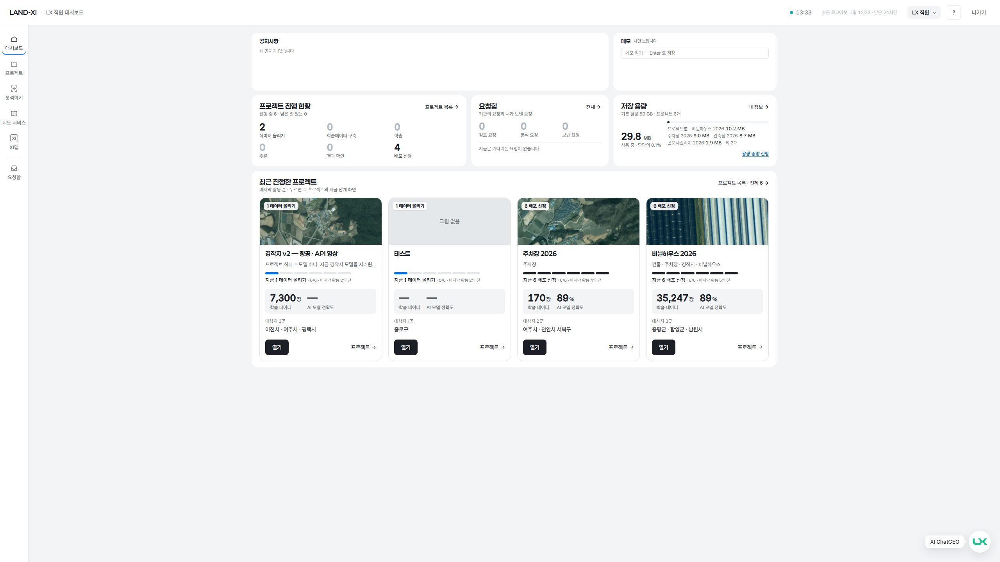 | 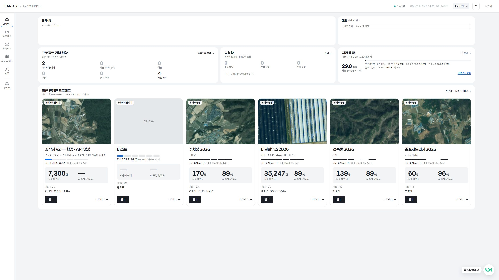 |
| 프로젝트 목록 2560 | 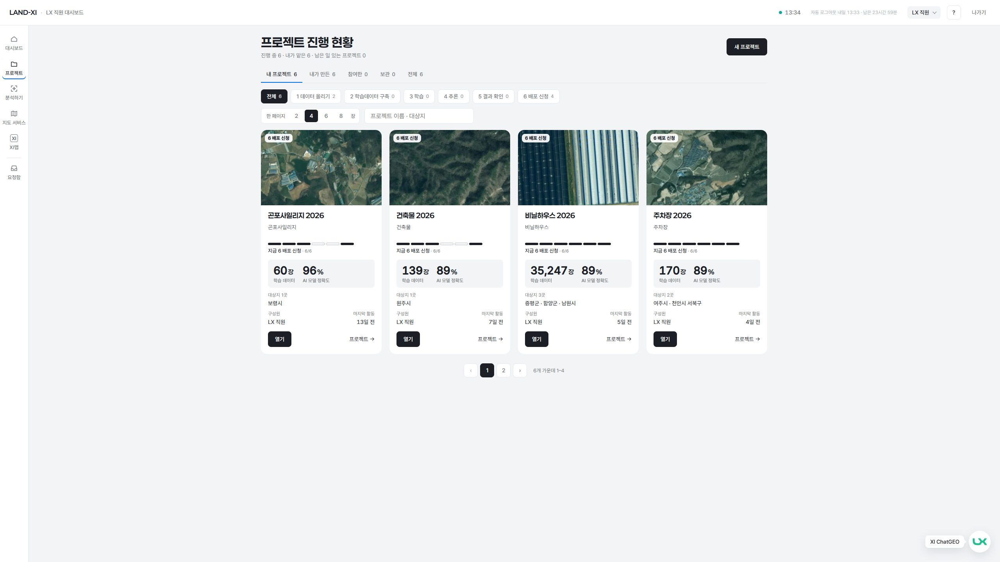 | 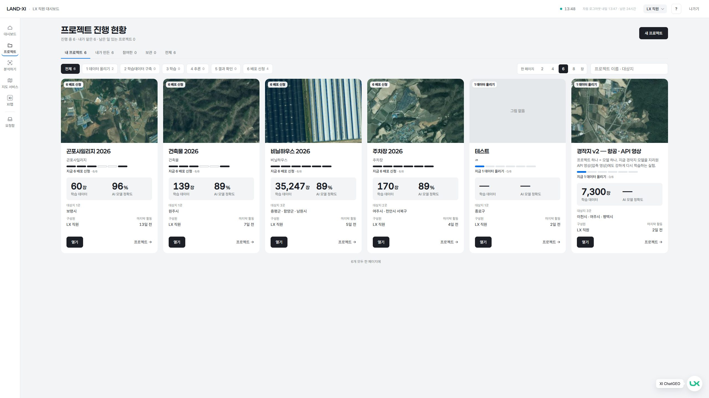 |
| 학습 2560 | 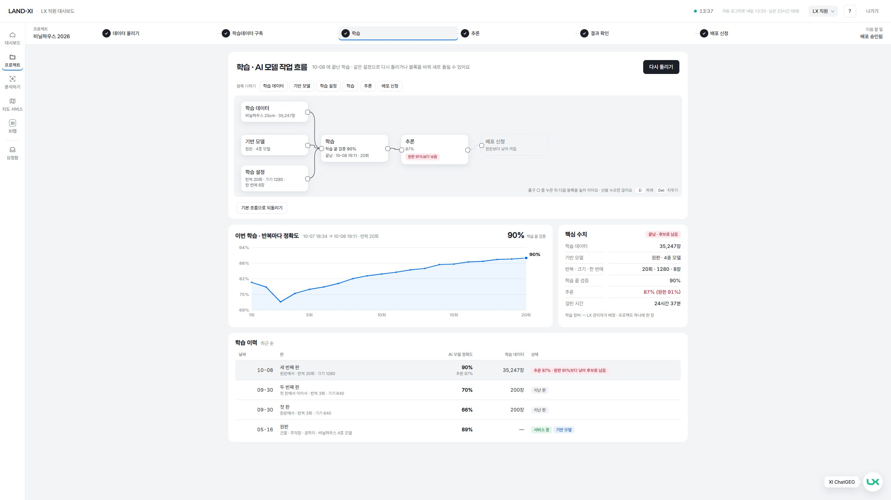 | 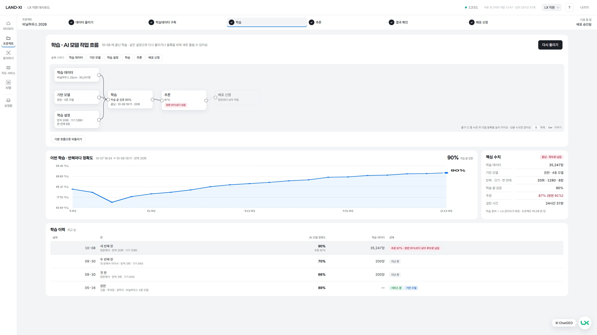 |
| 추론 2560 | 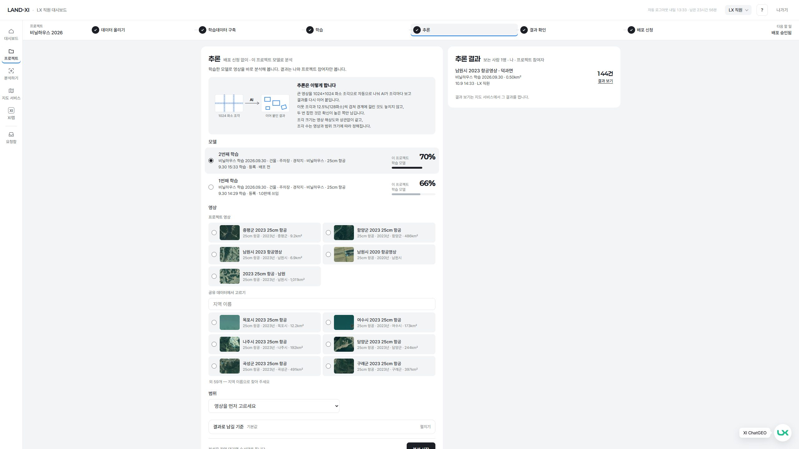 | 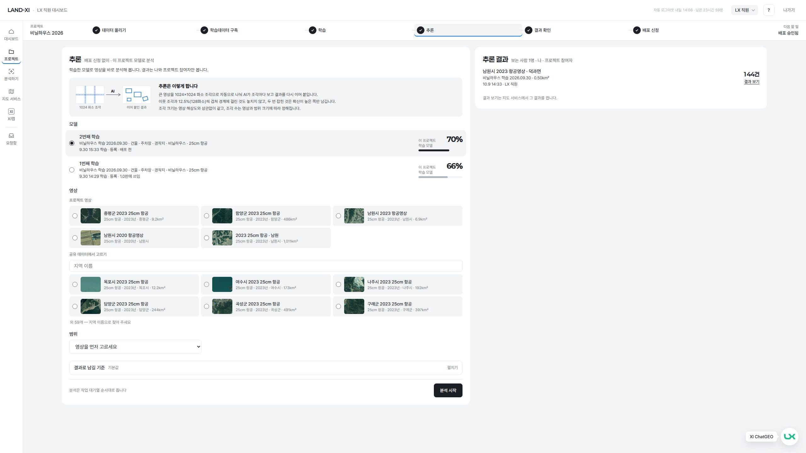 |
| XI맵 대시보드 2560 | 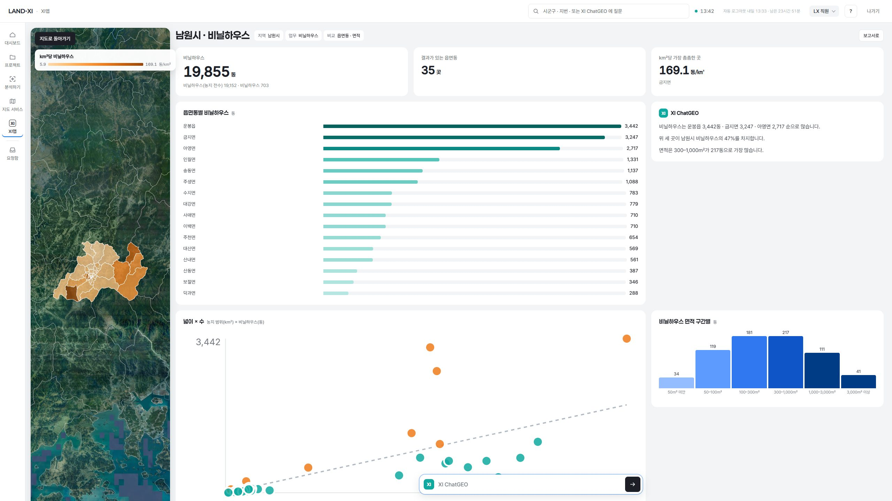 | 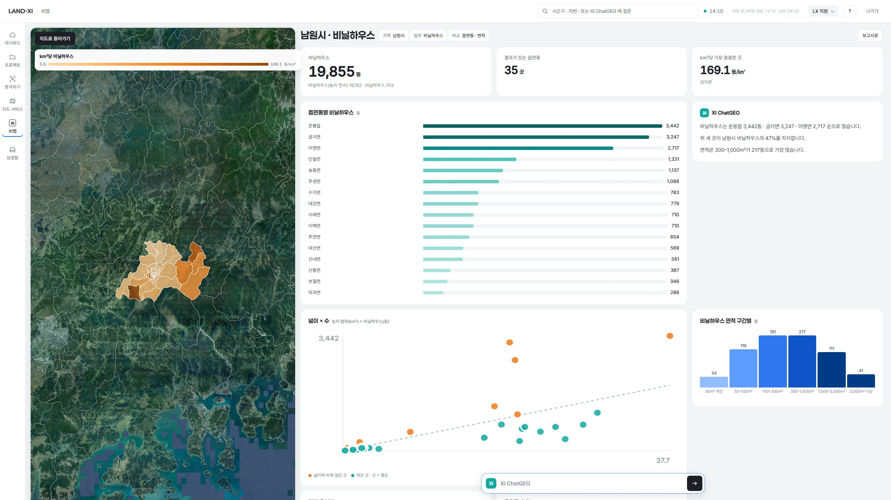 |
| 분석하기 1920 | 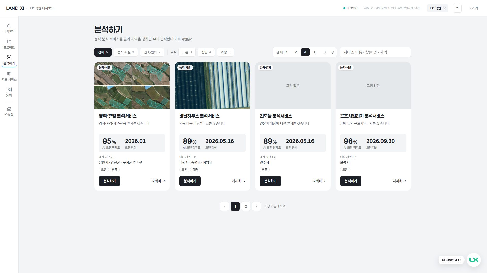 | 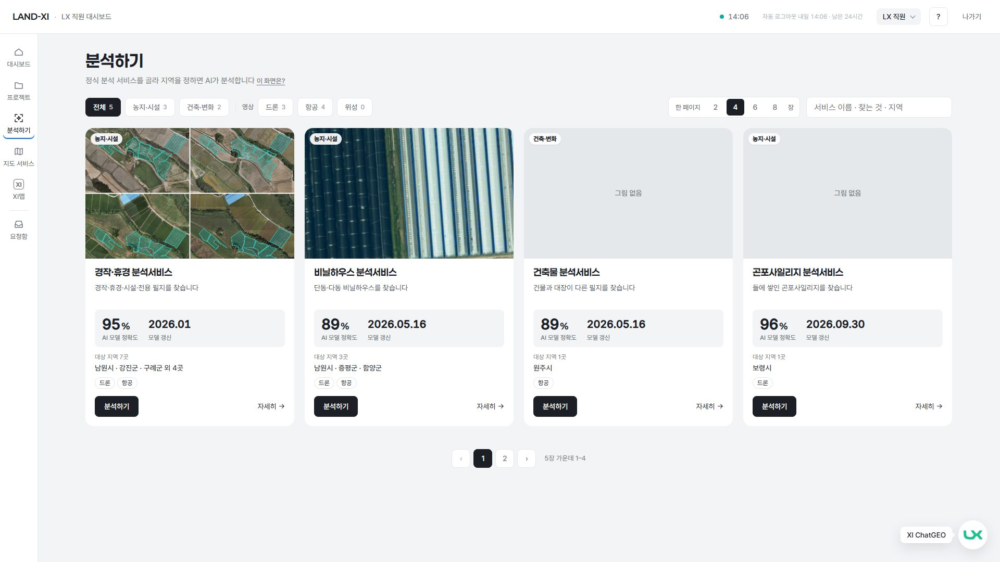 |
| 지원 1440 | 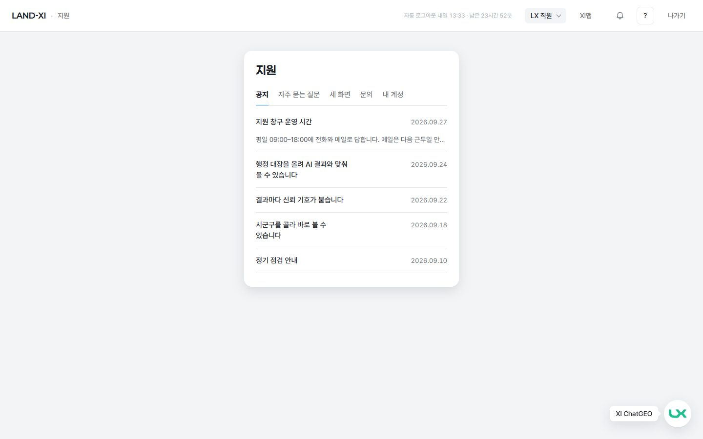 | 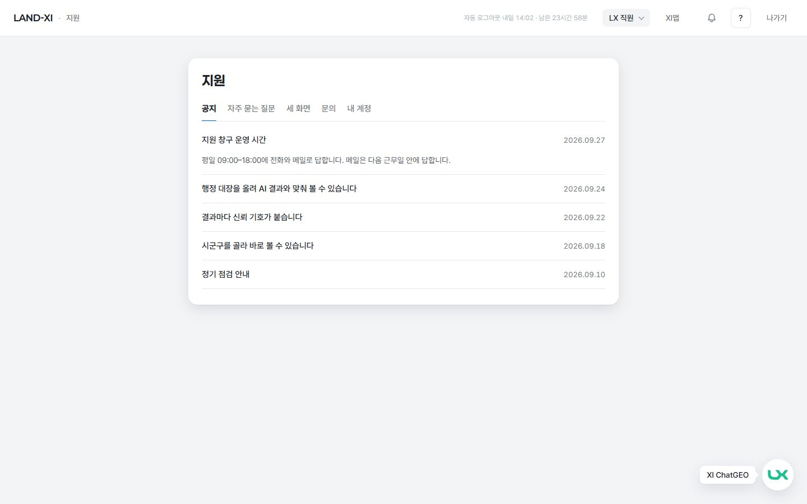 |
| XI맵 왼쪽 아래 1280 | 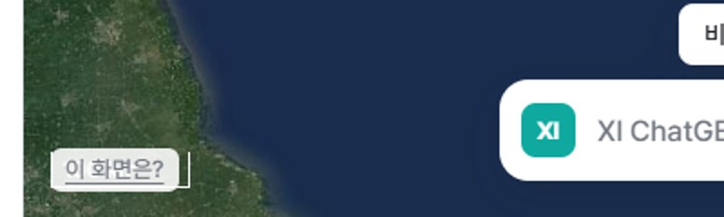 | 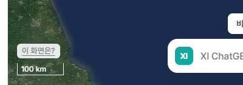 |

## 5. 고친 파일

- 공용(최소): `landxi/v3/kit/shell.css` — 변수 `--wide-max` 하나와 해상도 경계 둘만 더함. 이 변수를 쓰는 곳은 직원 화면뿐이라 관리자 · 기관 화면 모양은 바뀌지 않습니다.
- 직원 화면: lx-console(console.css · app.js 최근 프로젝트 장 수) · lx-project(project.css · context.css · app.js 기본 장 수) · lx-analyze(analyze.css · app.js 기본 장 수) · lx-cards/cards.css · lx-release/release.css · lx-train(board.css · train.css) · lx-inbox/inbox.css · help-my/help-my.css(지원 단독 화면 — 관리자 · 기관도 같은 화면이라 같이 넓어짐 · 서랍 안은 그대로)
- XI맵(CSS 크기만): xi-clean/dash.css(지도 판 폭 · 산점도 최대 높이) · xi-clean/xc.css('이 화면은?' 자리). dash.js 는 손대지 않았습니다.

## 6. 검증

- 콘솔 오류: 화면 코드 오류 0(고친 뒤 다섯 해상도 전부). 측정 중 게이트웨이 502 가 몇 번 났고, 그때 세션이 로그인 화면으로 떨어졌습니다(아래 제안 1).
- 가로 넘침: 18 화면 × 5 해상도 모두 0. 공용 변경 확인 — 관리자 화면(대시보드 · 인프라 · 지원) 1440 · 2560 가로 넘침 0 · 화면 오류 0(관리자 로그인 폼).
- e2e: impl3-shell · impl8-staff-dashboard · impl23-project · impl21-train-board · impl18-ximap · impl14b-mapsvc — 14 통과 · 1 건너뜀(기대값 바꾼 곳 없음).
- tools/check/words.mjs 통과(화면 금칙어 0 · 화면 오류 0) · numbers.mjs 통과.

## 7. 이런 것도 필요하지 않을까요?

1. **잠깐 끊긴 서버 응답에 로그아웃되지 않게** — 측정 중 게이트웨이가 몇 초 502 를 돌려주자 화면이 로그인으로 떨어졌습니다. 직원이 일하다 갑자기 로그인 화면을 보게 되니, 502 · 503 은 '잠시 뒤 다시 시도'로 두고 401 일 때만 로그인으로 보내면 어떨까요.
2. **프로젝트 한 장 화면의 큰 화면 배치** — 왼쪽 열에 '지금 단계' 카드 하나뿐이라 1920 이상에서 비어 보입니다. 오른쪽 세 카드(사람 · 다시 학습 · 기록)를 넓은 화면에서 두 줄로 펴는 안을 시안으로 보여 드릴 수 있습니다.
3. **XI ChatGEO 둥근 단추가 1280 에서 카드 위를 덮음** — 대시보드 · 프로젝트 화면 오른쪽 아래 카드 단추와 겹칩니다(공용 부품이라 이번에 손대지 않음).
4. **지원 단독 화면에 왼쪽 메뉴가 없음** — '이 화면은?'으로 들어오면 직원 메뉴가 사라집니다. 다른 직원 화면처럼 메뉴를 두면 길을 잃지 않습니다.
