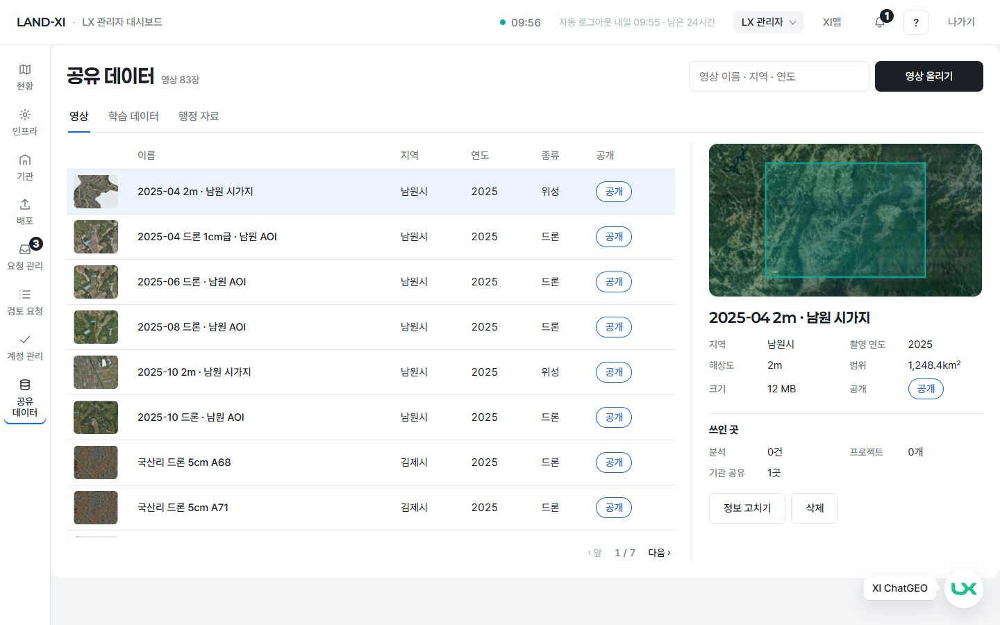
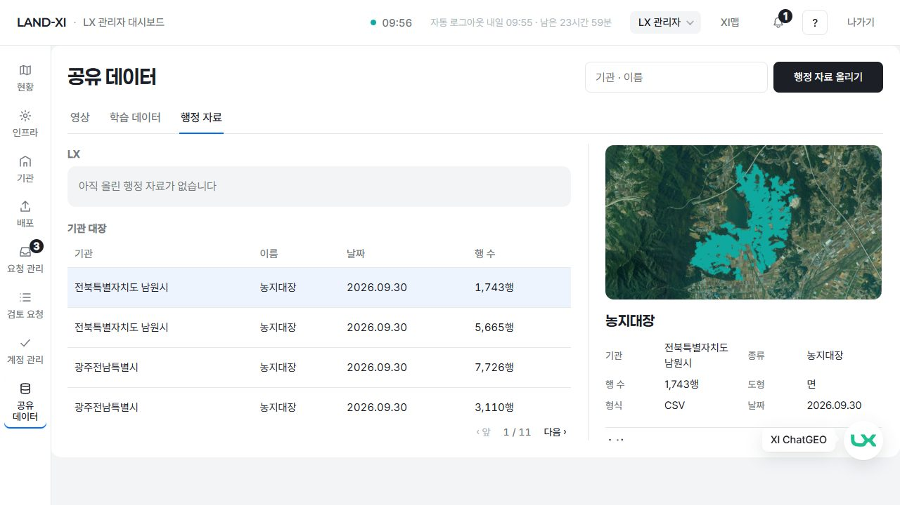
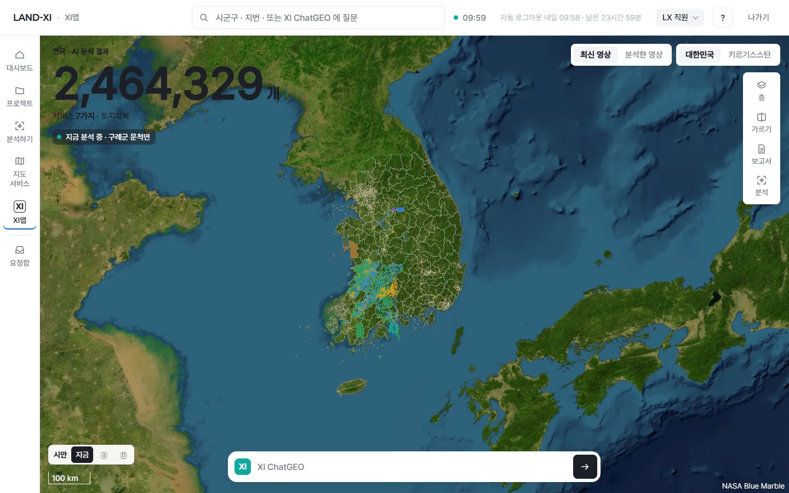
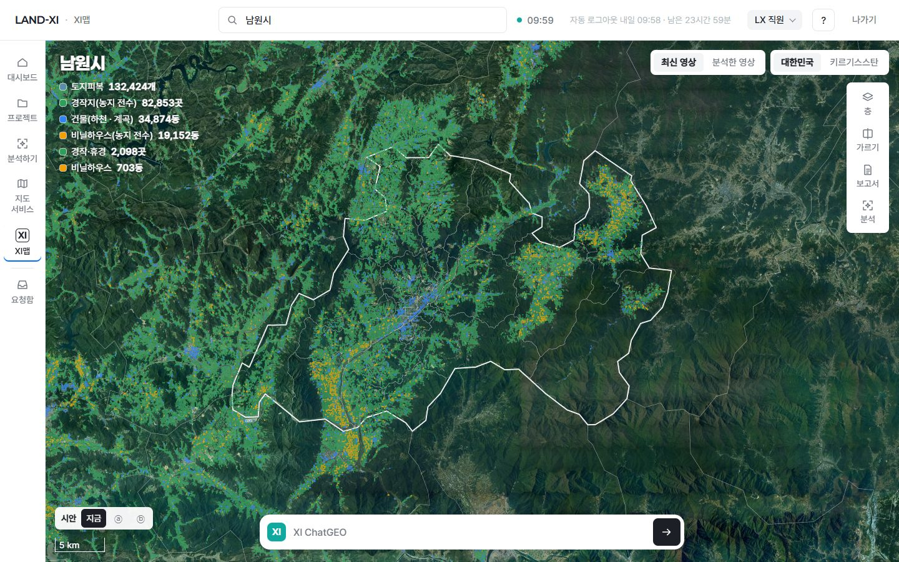
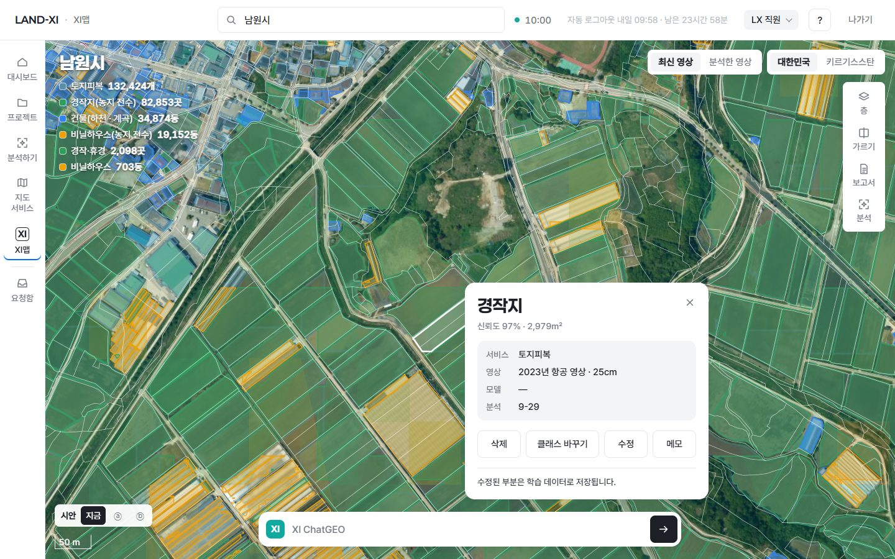
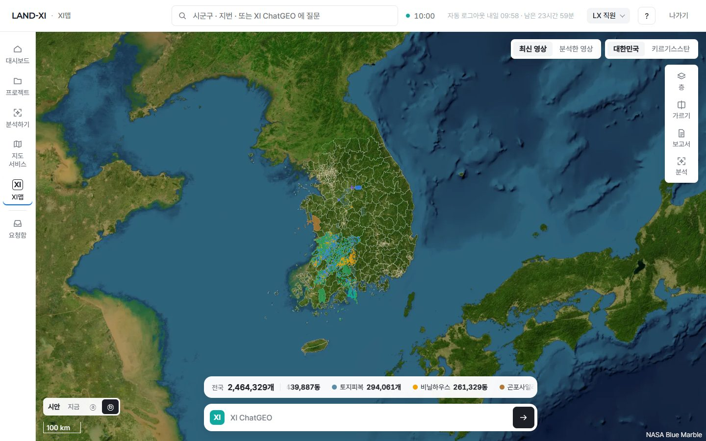
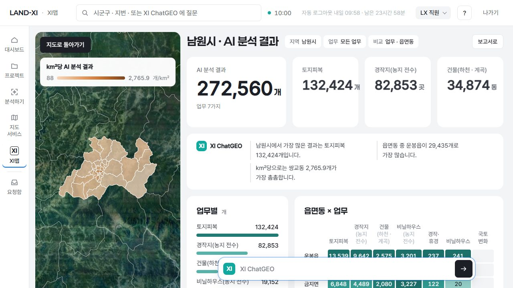
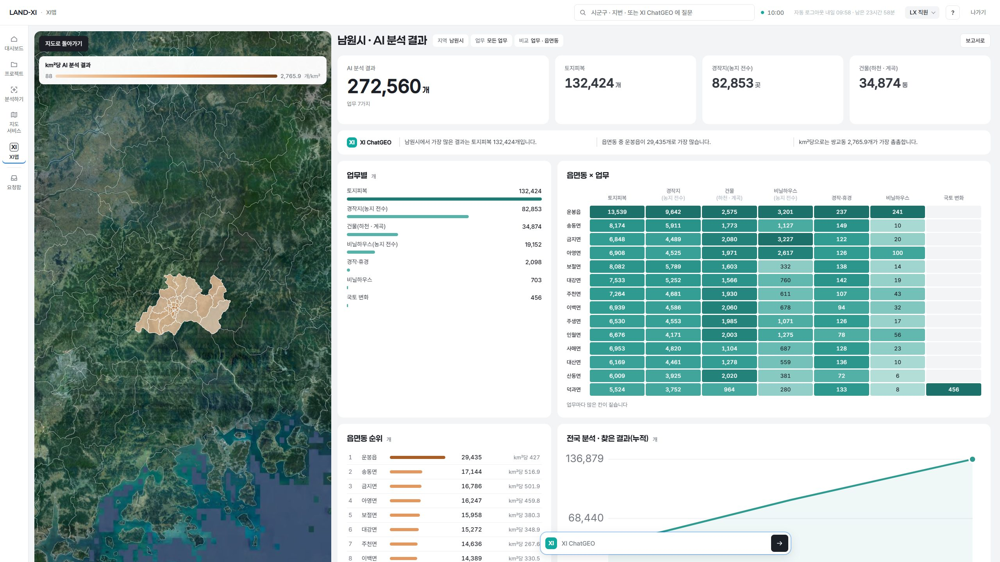

# 글자 크기 나머지 적용 · 글자 크기 검사기 · '삭제' 말 통일 (원칙 257 · 252 · 10-15)

- 찍은 방법: 바깥 주소를 로그인 폼으로 역할마다 한 번 들어가(LX 직원 · LX 관리자 — app · admin.land-xi.dev, 남원 기관 관리자 — namwon.land-xi.dev) 화면 27개 × 다섯 해상도(1280×720 · 1366×768 · 1440×900 · 1920×1080 · 2560×1440)를 쟀습니다. 측정 · 그림은 새 검사기 `tools/check/fonts.mjs` 로 했습니다.
- 그림 전체(약 135장)는 저장소 밖에 두고, 아래 대표 그림만 넣었습니다.

## 1. 글자 크기 나머지 적용(글자크기-나머지)

| 화면 · 파일 | 바꾼 곳 | 어떻게 |
|---|---|---|
| 관리자 공유 데이터 — `ops-infra/shared.css` | 글자 선언 25곳(13px 11 · 14px 6 · 15px 6 · 16 · 18 · 22 · 옛 이름 1) | 표 머리 · '공개' 단추 · 입력 라벨 · 상세 값 → 보조 15 / 페이지 줄 · 오류 · 안내 · 숫자 꼬리 → 꼬리표 14 / 없음 안내 · 탭 · 삭제 확인 글 → 본문 16 / 상세 제목 18 → 제목 2 20 / 화면 제목 22 → 제목 1 28 |
| XI맵 — `xi-clean/xc.css` | 옛 이름 23곳(`--fs-label` 18 · `--fs-sub` 2 · `--fs-h4` 3) · px 10곳 | 라벨 · 단추 · 칩 → 보조 15 / 지도 위 꼬리 글 · 작은 설명 → 꼬리표 14 / 질문 입력 → 본문 16 / 창 · 고치기 칸 제목 24 → 제목 1 28 / 지역 이름 22 → 28 · 큰 숫자 64 → 큰 숫자 80 · 진행 숫자 28 → 28(토큰) · 끝난 숫자 44 → 48 · 결과 표시 시안 숫자 44 → 48 |
| XI맵 융합 대시보드 — `xi-clean/dash.css` | px 5곳 | 제목 30 → 제목 1 28 · 칸 숫자 34 → 숫자 32 · 주 숫자 52 → 48 · 단위 · 막대 숫자 20 → 제목 2 20 |
| 영상 출처 글 — `kit/stage.js` `.k-credit` | 1곳 | 12px → 꼬리표 14('NASA Blue Marble' · Sentinel 출처) |
| 서비스 카드 제목 칸 — `kit/kit.css` | 1곳 | 옛 줄 높이(`--lh-h4`)로 두 줄 칸을 잡던 것 → 제목 1 줄 높이(카드 제목 두 줄 칸이 실제 글자와 맞게) |

- 휴대폰(640 이하) 전용 크기 네 곳(XI맵 큰 숫자 40 · 지역 제목 28 · 결과 표시 숫자 40/20)은 지난번처럼 그대로 두었습니다.
- 커져서 생긴 칸 문제는 칸으로 고쳤습니다(글자를 다시 줄인 곳 0): 융합 대시보드 '읍면동 × 업무' 표의 업무 이름이 '비닐하우 / 스'처럼 글자 중간에서 꺾이던 것 → 읍면동 이름 칸을 내용 폭으로, 업무 칸을 가장 긴 낱말 폭 이상으로(모자라면 칸 안 가로 스크롤 — 다섯 해상도 모두 스크롤 없이 들어감).
- 옛 이름 토큰(`--fs-label` · `--fs-sub` · `--fs-h4`): 운영 화면(landxi/v3)에서 쓰는 곳 **0**. 지난 시안 보관 페이지(proto/review — 배포 흐름 · 직원 대시보드 시안 등 13개)가 아직 써서 토큰 정의는 남기고 '보관 페이지만'이라고 적었습니다(법전 §2-0 고침).

| 화면 | 그림 |
|---|---|
| 관리자 공유 데이터(영상 + 상세) 1440 |  |
| 관리자 공유 데이터(행정 자료) 1280 |  |
| XI맵 전국 1440(큰 숫자 80 · 출처 14) |  |
| XI맵 시군구(남원) 1440 |  |
| XI맵 고치기 칸 1440 |  |
| XI맵 결과 표시 시안 ⓑ 1440 |  |
| XI맵 융합 대시보드 1280 · 2560 |   |

## 2. 글자 크기 검사기(글자크기-검사기) — `tools/check/fonts.mjs`

`words.mjs` · `numbers.mjs` 옆. 바깥 주소를 로그인 폼으로 역할마다 **한 번만** 로그인해(최대 3번 — 바깥 로그인 한도 10분 20번 안) 주요 화면 27개를 열고, 보이는 글마다 계산된 글자 크기를 셉니다.

- 실패: **14px 미만 글** · **단계 밖 크기**(단계 = 그 화면이 읽은 `--fs-*` 토큰 값, 옛 이름 셋은 빼고) · 화면 오류.
- 의도된 예외(목록으로 코드에): 지도 라이브러리 기본 표시(출처 · 팝업 닫기 '×' · 확대 단추) · 개발자 서랍(`?dev=1`) · `[data-lint-skip]`.
- `--widths 1280,1366,1440,1920,2560` 을 주면 같은 화면을 폭마다 다시 재고, 칸 경고(가로 넘침 · 화면 밖 칸 · 제목 3줄 이상 · 한 단어만 남은 줄 · 글자 중간 끊김)도 적습니다. `--chat` 은 XI ChatGEO 질문 하나로 융합 대시보드까지 엽니다. `--shots 폴더` 는 그림을 남깁니다.
- 화면: 기관(내 서비스 · 서비스 대시보드 · 보고서 · 필지 목록 + 상세 · 요청하기 둘) · LX 직원(대시보드 · 분석하기 · 지도 서비스 · 요청함 · 프로젝트 · 학습 · 배포 신청서 · XI맵 전국 · 시군구 · 결과 표시 시안 ⓐ ⓑ · 고치기 칸 · 융합 대시보드) · LX 관리자(대시보드 · 요청 관리 · 인프라 · 배포 신청 · XI 재학습 · 공유 데이터 탭 셋 + 상세).

**결과(10-15, 다섯 해상도) — 통과**: 화면 27개 모두 14px 미만 0 · 단계 밖 0 · 화면 오류 0. 쓰인 크기는 14 · 15 · 16 · 20 · 28 · 32 · 40 · 48 · 80 뿐입니다. → `fonts-check.txt` · `fonts-app-check.txt`

칸 경고(실패 아님): 융합 대시보드 표 머리 '건물(하천 · 계곡)'의 작은 덧말이 좁은 칸에서 '(하천 · / 계곡)' 두 줄 · 1280 에서 '경작· / 휴경'이 가운뎃점에서 꺾임(낱말 사이 끊김 — 글자 중간 끊김 아님). 그 밖 가로 넘침 · 화면 밖 칸 · 제목 3줄 · 한 단어 줄 0.

## 3. '삭제' 말 통일(삭제-말통일 · 원칙 252)

| 화면 | 그전 | 지금 |
|---|---|---|
| 배포 신청서(LX 직원) · 배포 신청 승인(LX 관리자) · XI 재학습(LX 관리자) | 지운 자리 n곳 중 다시 잡은 곳 m곳 | **삭제한 자리** n곳 중 다시 잡은 곳 m곳 |
| 관리자 공유 데이터 — 상세 단추 · 확인 창 단추 · 알림 | 지우기 · 지웠습니다 | 삭제 · 삭제했습니다 |
| 프로젝트 기록 — 메모 · 파일 줄 단추 · 확인 창(제목 · 단추 · 안내) · 알림 | 지우기 · 메모 지우기 · 지우면 되돌릴 수 없습니다 · 메모를 지웠습니다 | 삭제 · 메모 삭제 · 삭제하면 되돌릴 수 없습니다 · 메모를 삭제했습니다(안내의 기록 문구 인용은 '누가 삭제했는지 한 줄'로) |
| 직원 대시보드 메모 | 지우기 · 메모를 지웠습니다 | 삭제 · 메모를 삭제했습니다 |
| 요청함 | 지워진 요청입니다 | 삭제된 요청입니다 |
| 학습 흐름 판 도움말 | Del 지우기 | Del 삭제 |
| 기관 촬영 요청 지도 | 지우기(그린 범위) | 범위 삭제 |
| XI맵 조건 칩 | 조건 지우기 | 조건 삭제 |

- 시험 기대값 고침: `tests/e2e/impl5-account-extras.spec.mjs`(확인 창 제목 '메모 삭제' · 단추 '삭제').

## 4. 검증

- 다섯 해상도 · 바꾼 화면: 가로 넘침 0 · 제목 3줄 이상 0 · 한 단어 줄 0(위 표 머리 덧말 하나 빼고) · 글자 중간 끊김 0 · 콘솔 오류 0(fonts.mjs 화면 오류 0).
- `fonts.mjs` 통과 · `words.mjs` · `numbers.mjs` → `words-check.txt` · `numbers-check.txt` · e2e → `e2e.txt`.
- 서버 · 워커 재시작 0(화면 파일만).

## 5. 남은 것

1. **서버가 만드는 '지움' 말 넷**(서버를 다시 켜야 바뀌어 이번에 손대지 않음): 프로젝트 기록 줄 '메모를 지움 · 파일을 지움'(projects.py) · 결과 확인 상태 '지움'(spaces.py) · 영상 표준 변환 상태 '지움'(imagery_std.py) · 원본 보관 '원본 지움 · 표준본으로 씀'(catalog.py). 다음 서버 재시작 때 '삭제함'으로 바꾸면 화면 말이 모두 같아집니다(시험 test_impl5_account_extras 기대값도 함께).
2. 옛 이름 토큰 정의 — 지난 시안 보관 페이지가 쓰는 동안 남김(운영 화면 0).
3. 휴대폰(390) 화면은 이번에도 재지 않았습니다.

## 6. 이런 것도 필요하지 않을까요?

1. **배포 때 fonts.mjs 를 words.mjs · numbers.mjs 와 함께 자동으로** — 누가 · 왜: 새 화면을 만드는 에이전트가 다시 작은 글자를 넣는 것(사용자 지적 '작게 하는 경향')을 배포 전에 막습니다.
2. **'조건 삭제' 대신 '조건 풀기'** — 누가 · 왜: XI맵을 쓰는 직원. 거르기 조건은 데이터를 지우는 것이 아니라 거르기를 푸는 것이라, '삭제'가 결과를 지우는 것으로 읽힐 수 있습니다(이번엔 지시대로 '삭제'로 맞춤).
