# 글자 크기 표준화 — 직원 · 관리자 · 기관 · 메인 (원칙 257 · 10-15)

사용자 원문(10-15): "그리고 폰트의 크기가 뒤죽박죽인데 조금 표준화해라. 일단 너무 작은건 싫다. 너는 작게 하는 경향이 크다." · 보충: "참고로 대시보드 메인 글자 크기는 전체적으로 좀 작다. 이 기준으로 잘 적용해라"

- 찍은 방법: 바깥 주소를 로그인 폼으로 한 번씩 들어가 세션을 유지했습니다(LX 직원 · LX 관리자 — app.land-xi.dev, 남원 기관 관리자 — namwon.land-xi.dev, 메인 · 로그인 · 남원 기관 메인은 로그인 없이). 화면 53개 × 해상도 5(1280×720 · 1366×768 · 1440×900 · 1920×1080 · 2560×1440)를 고치기 전 · 후로 찍고 쟀습니다.
- 잰 것: 화면에 보이는 글(글이 직접 들어 있는 요소 · 입력 칸)마다 계산된 글자 크기, 그리고 가로 넘침 · 화면 밖 칸 · 제목 3줄 이상 · 한 단어만 남은 줄 · 말줄임 · 칸 밖으로 잘린 글.
- 그림 전체(약 270장 × 2)는 저장소 밖에 두고, 아래 대표 그림만 넣었습니다.

## 1. 진단(전) — 1440 기준, 화면 53개

**글자 크기 24가지**가 섞여 있었습니다: 11 · 11.5 · 12 · 12.5 · 13 · 13.5 · 14 · 15 · 16 · 17 · 18 · 20 · 22 · 24 · 26 · 28 · 30 · 32 · 40 · 48 · 56 · 64 · 80 · 124px.
글 4,225곳 중 **14px 미만이 1,673곳(40%)** — 그중 12.5px 이하가 607곳, 13 · 13.5px 가 1,066곳.

| 크기(px) | 쓰인 곳 | 화면 수 | 예 |
|---|---|---|---|
| 11 | 68 | 35 | 메뉴 'XI' 표기 · '나만 보입니다' · '· 6/6' |
| 11.5 | 4 | 1 | 학습 서식 '빠질 수 없음' |
| 12 | 527 | 50 | 자동 로그아웃 시각 · '최근 결과' · 영상 날짜 꼬리표 |
| 12.5 | 8 | 2 | 학습 서식 '반복 횟수 · 회' |
| 13 | 1,060 | 53 | '새 알림이 없습니다' · '첫 결과 전' · 표 칸 |
| 13.5 | 6 | 2 | 글 입력 칸 · 2차 단추 |
| 14 | 1,568 | 53 | 메뉴 · 역할 표기 · 단추 |
| 15 | 336 | 35 | '무엇이' · 'AI 분석 결과 · 남원시' |
| 16 | 296 | 53 | 기관 이름 · 설명 한 줄 |
| 17 · 18 | 75 | 15 | 카드 제목 |
| 20 · 22 · 24 · 26 | 180 | 28 | 칸 제목 · 카드 숫자 |
| 28 · 30 · 32 | 67 | 16 | 화면 제목 · 숫자 |
| 40 이상 | 30 | 17 | 큰 숫자 · 소개형 제목 · 지도 HUD |

| 묶음 | 화면 | 글 | 14px 미만 | 12.5px 이하 | 크기 가짓수 |
|---|---|---|---|---|---|
| LX 직원 | 16 | 1,491 | 723 | 400 | 15 |
| LX 관리자 | 20 | 1,546 | 551 | 161 | 18 |
| 기관(남원) | 14 | 1,045 | 379 | 46 | 17 |
| 메인 · 로그인 | 3 | 143 | 20 | 0 | 15 |

가장 작았던 화면은 **LX 직원 대시보드**(글 128곳 중 80곳이 14px 미만, 57곳이 12px 이하) · 추론 · 서비스 카드 · 프로젝트 목록 · 관리자 인프라 · 배포 탭이었습니다.

## 2. 표준 단계(법전 §2-0 · 토큰 `landxi/v3/shared/tokens-v2.2.css` — kit.css 가 모든 화면에 넣음)

| 단계 | 토큰 | 데스크톱(크기/줄) | 쓰는 곳 | 그전 |
|---|---|---|---|---|
| 큰 숫자 | `--fs-big` | 80/88 · 지도 HUD 한 곳 124 | 화면당 하나 | 그대로 |
| 숫자 | `--fs-num` | 32/40 · tabular | 카드 · 칸 안 숫자 | 22–30 |
| 제목 1 | `--fs-t1` | 28/36 | 화면 · 창 · 서랍 제목 | 22–28 |
| 제목 2 | `--fs-t2` | 20/28 | 카드 · 칸 제목 · 소제목 | 16–21 |
| 본문 | `--fs-body` | 16/26 | 문장 · 입력 · 목록 | 15–16 |
| 보조 | `--fs-aux` | 15/22 | 라벨 · 단추 · 칩 · 표 · 메뉴 | 13–14 |
| 꼬리표 | `--fs-tag` | 14/20 | 단위 · 날짜 · 작은 설명(가장 작은 글자) | 11–12.5 |

- **바닥: 꼬리표 14 · 보조 15 · 본문 16** — 12px 이하 · 13px 는 쓰지 않습니다. 표 숫자는 tabular(`--font-num` · `.num`).
- **대시보드 메인(직원 대시보드 · 관리자 현황 카드 · 기관 서비스 대시보드)은 한 단계 더**: 그전 12 → 보조 15, 13–14 → 본문 16, 카드 제목 16–18 → 20, 칸 숫자 24 → 32.
- 소개형 화면(메인 · 기관 메인 · 영업)의 큰 제목만 `--fs-xl` 40 · `--fs-h2` 48 을 더 씁니다. 지도 HUD 숫자 · 휴대폰 전용 크기 다섯 곳(56 · 64 · 52 · 72 · 96)은 그대로 둡니다.
- 브라우저 기본 `small`(83%)이 14 밑으로 내려가지 않게 바닥 규칙 한 줄 · 글 입력 칸(textarea)도 화면 글자를 따르게 했습니다.

## 3. 후 — 같은 53 화면 × 5 해상도

| | 전 | 후 |
|---|---|---|
| 쓰인 크기(이번에 고친 화면) | 24가지 | **14 · 15 · 16 · 20 · 28 · 32 + 큰 숫자 · 소개형 제목(40 · 48 · 56 · 64 · 80)** |
| 14px 미만 글(이번에 고친 화면, 1440) | 1,673곳 | **3곳** — 모두 지도 영상 출처 'NASA Blue Marble'(영상 층 stage.js — 이번 범위 밖) |
| 가로 넘침 | 0 | 0 (5 해상도 모두) |
| 화면 밖 칸 | 0 | 0 |
| 제목 3줄 이상 | 0 | 0 |
| 한 단어만 남은 줄 | 2 | 0 |
| 말줄임(…) | 10 | 10 — 늘어난 곳 0 |

화면별 바꾼 글자 크기 선언 수(CSS 59개 파일 · px 값 1,280곳 남짓 → 토큰):

| 묶음 | 파일 | 바뀐 줄 |
|---|---|---|
| 공용(kit · 토큰) | 14 | 224 |
| LX 직원(대시보드 · 프로젝트 · 학습 · 추론 · 결과 확인 · 배포 신청 · 분석하기 · 서비스 카드 · 지도 서비스 · 요청함 · 지원 등) | 16 | 456 |
| LX 관리자(현황 · 요청 관리 · 인프라 · 기관 · 배포 · 계정) | 10 | 333 |
| 기관(내 서비스 · 서비스 대시보드 · 요청하기 · 보고서 · 행정정보와 비교 · 기관 정보 · 계정) | 11 | 284 |
| 메인 · 로그인 · 기관 메인 · 영업 · API 안내 · 세계 · 서비스 상세 | 8 | 197 |

글자가 커져 생긴 칸 문제는 **칸 크기 · 줄바꿈으로** 맞췄습니다(글자를 다시 줄인 곳 0):
- 지도 서비스 왼쪽 판 296 → 344(묶음 이름이 '…'로 잘리던 것) · 추론 모델 정확도 칸 140 → 176('이 / 프로젝트 / 학습 모델' 한 단어씩 꺾이던 것)
- 요청 관리 분석 요청 줄 마지막 칸 112 → 128('급 / 함' 단추 꺾임) · 개선 후보 표 역할 칸 최소 112('…기관' 한 단어 줄)
- 기관 보고서 개요 숫자 단위('필지 · 205.0ha')가 칸 밖으로 잘리던 것 → 숫자 아래 줄로 · 1280 에서 고르기 두 칸 + 단추 두 개를 두 줄로
- 직원 대시보드 저장 용량 프로젝트 이름 폭 110 → 150 · 최근 프로젝트 카드 '지금 단계 · 마지막 활동' 줄은 말줄임 대신 두 줄
- 메뉴 · 알림 숫자 동그라미 20(숫자 14) · 메뉴 글은 꼬리표 14('지도 서비스' · '공유 데이터'는 두 줄) · 지도 축척 글 한 줄

## 4. 대표 그림(전 → 후)

| 화면 | 전 | 후 |
|---|---|---|
| LX 직원 대시보드 1440 | 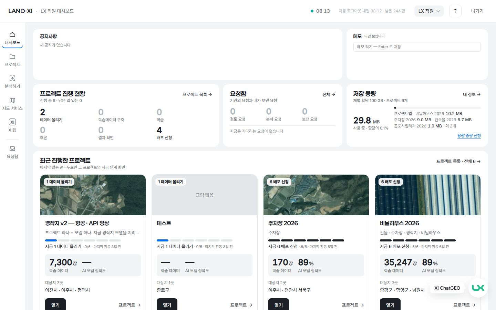 | 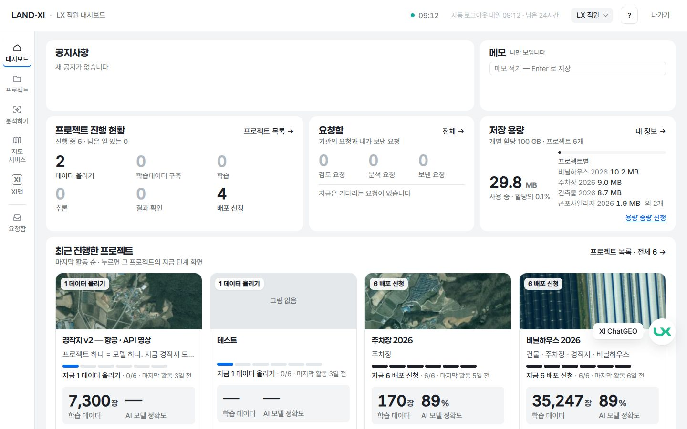 |
| LX 직원 대시보드 2560 | 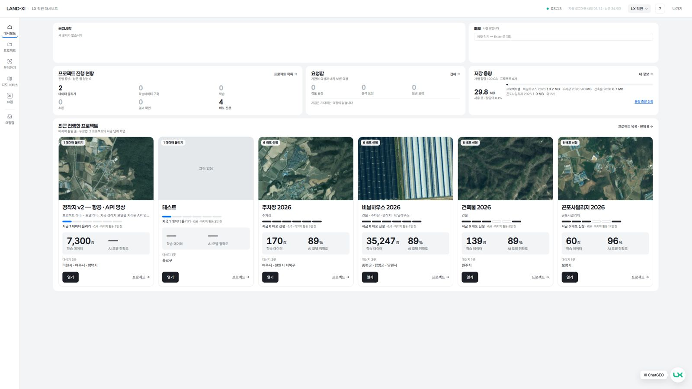 | 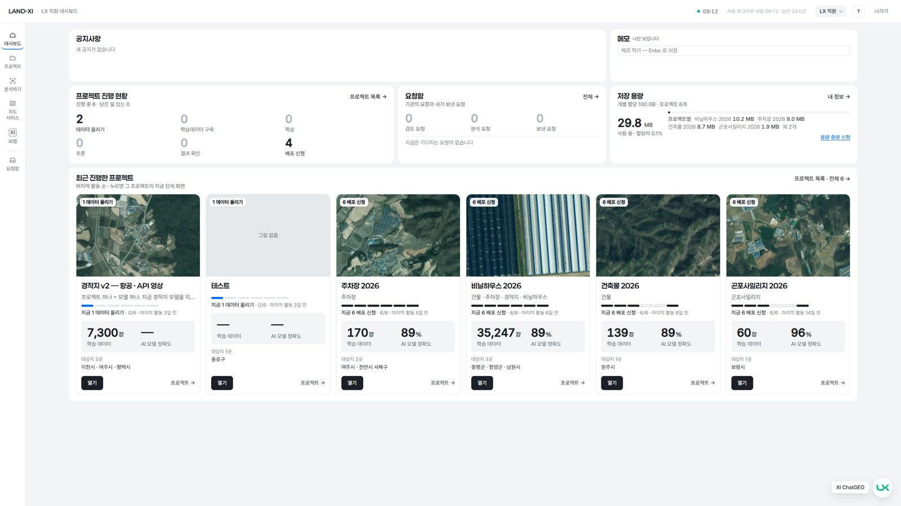 |
| LX 관리자 대시보드 1440 | 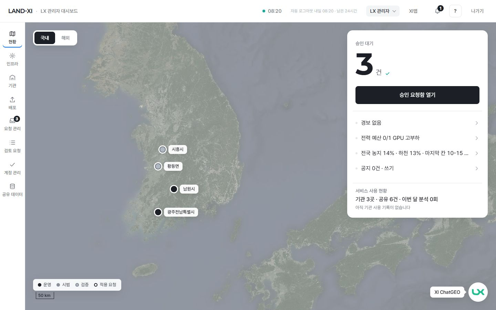 | 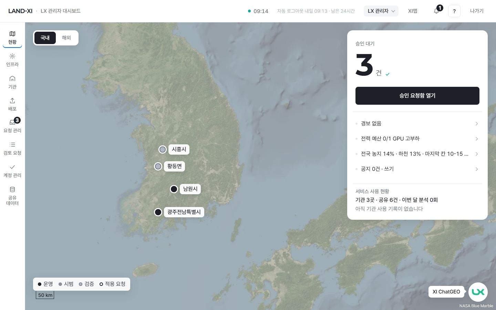 |
| 기관 서비스 대시보드 1440 | 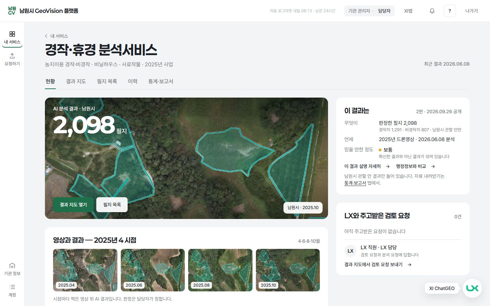 | 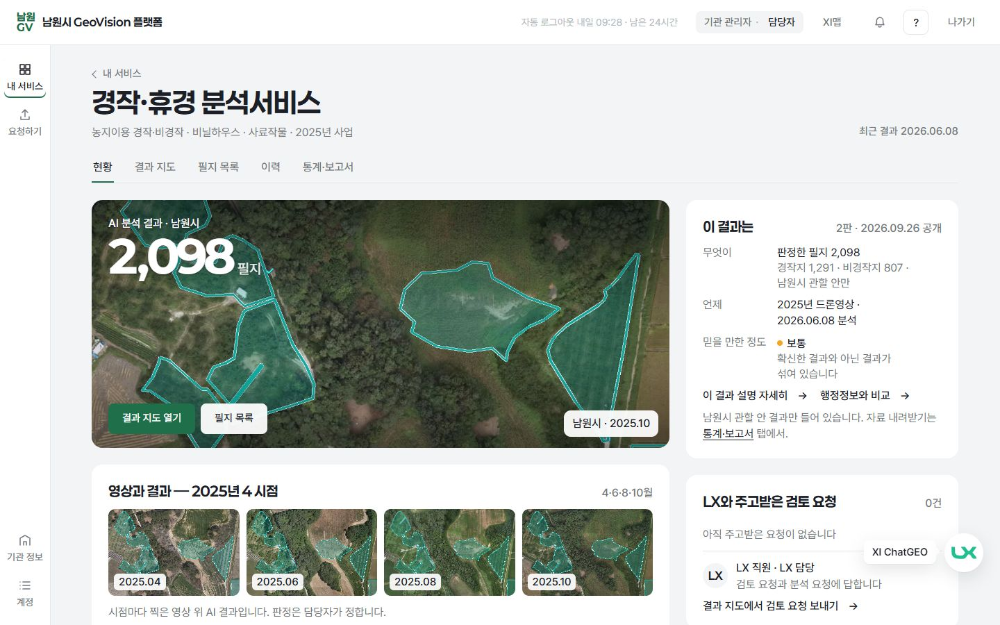 |
| 직원 추론 1280 | 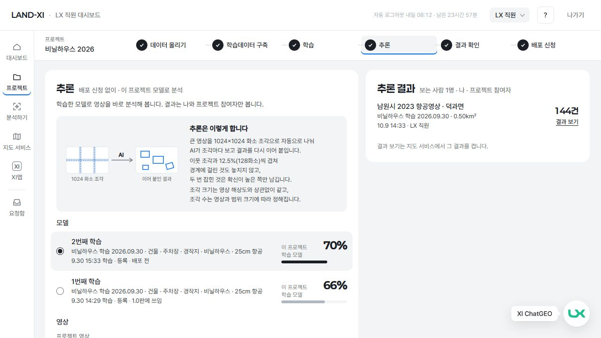 | 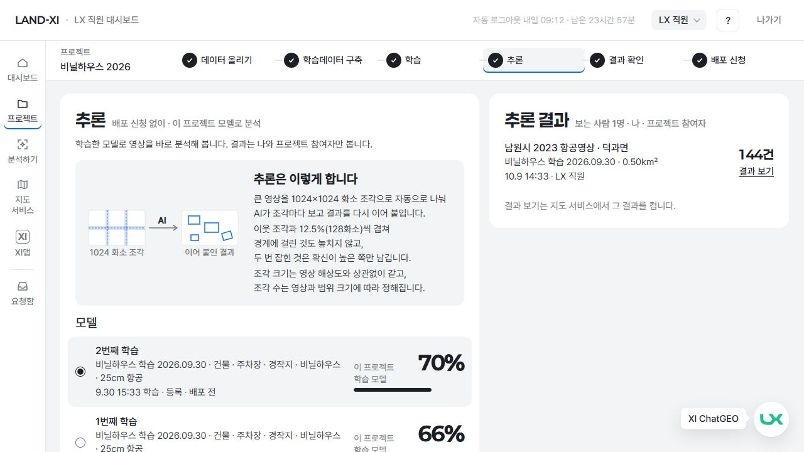 |
| 관리자 요청 관리 1440 | 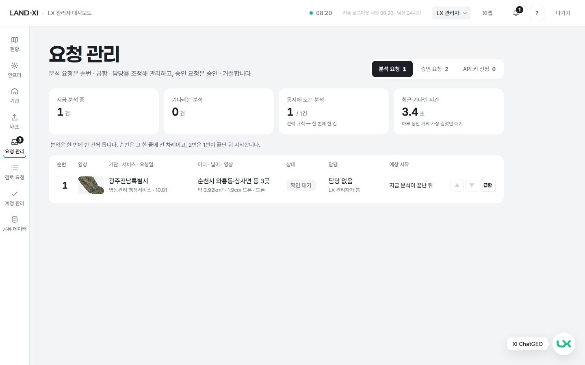 | 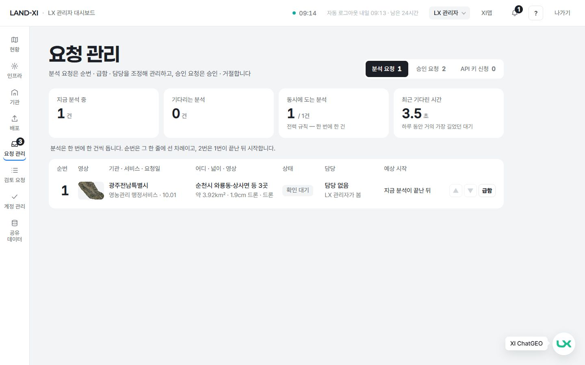 |
| 직원 결과 확인(지도 서비스) 1440 | 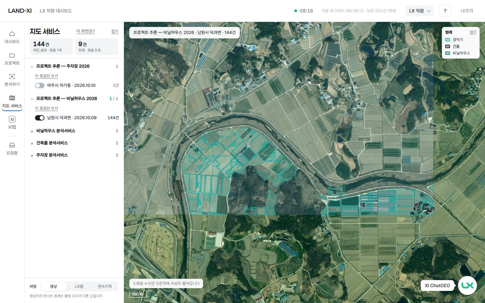 | 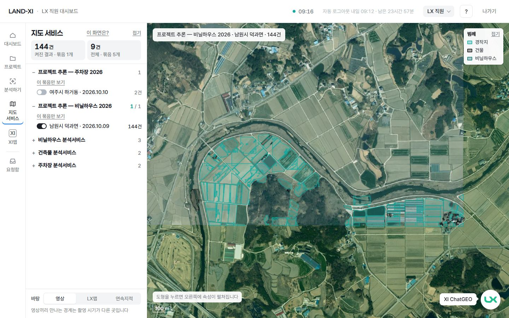 |
| 기관 보고서 1280 | 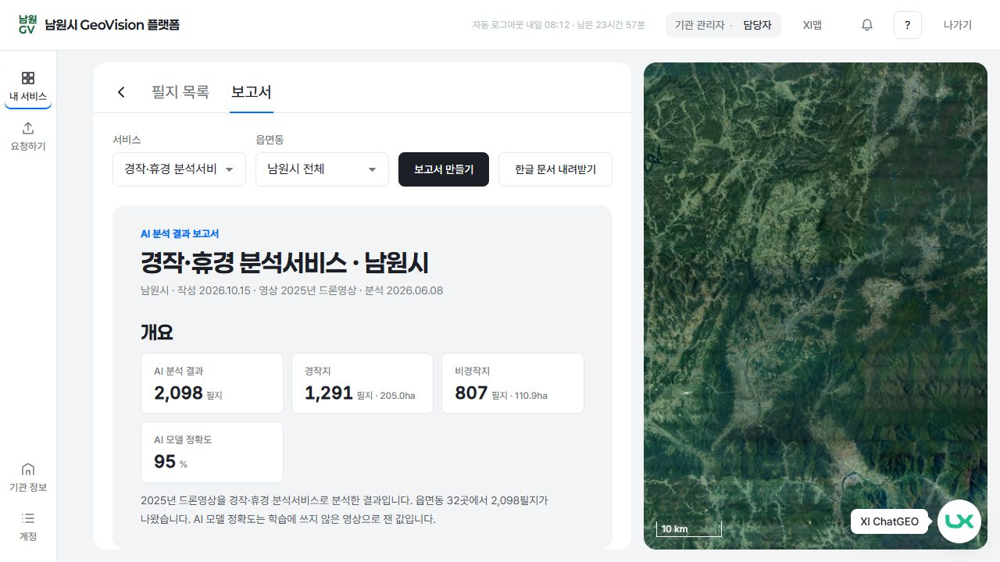 | 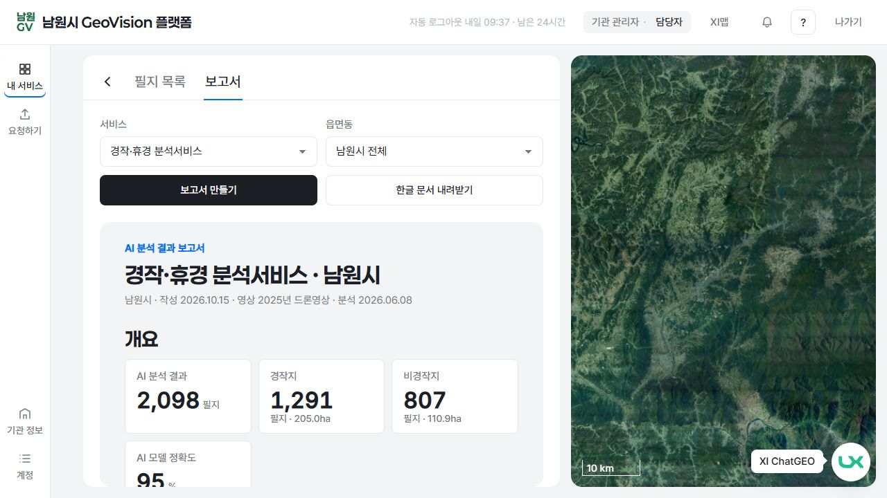 |

## 5. 남은 것 — XI맵 · 관리자 공유 데이터 · 영상 층(다른 작업이 고치던 파일 — 이번에 손대지 않음)

토큰은 먼저 만들어 두었습니다(`--fs-tag` · `--fs-aux` · `--fs-t2` · `--fs-t1` · `--fs-num`). 아래는 측정 시점(10-15) 그 화면들에 남은 작은 글입니다.

| 화면 · 파일 | 남은 작은 글 |
|---|---|
| 관리자 공유 데이터(영상 · 학습 데이터 · 행정 자료) — `ops-infra/shared.css` | 13px 45곳(표 머리 · '보기' 단추 · 숫자 칸) · px 값 23곳(13 ×8 · 14 ×6 · 15 ×6 · 16 · 18 · 22) — 선택자 `.sd-n` `.sd-tbl th` `.sd-vis` `.sd-none` `.sd-sub` `.sd-pg` `.sd-form label` `.sd-err` `.sd-file` `.sd-msg` `.sd-cls-f` `.sd-kv dt` `.sd-d-tbl` `.sd-d-tbl th` · 공유 데이터 상세 표가 안쪽 가로 스크롤 62 |
| XI맵 — `xi-clean/xc.css` · `dash.css` | 측정 때 도구 이름 13px 9곳(`.xc-tool-l` — 그쪽 작업에서 이미 `--fs-tag` 로 옮김) · 옛 이름 `--fs-label`(14) 18곳 → `--fs-aux` 로 옮기면 됨 · px 값 19곳(20 · 22 · 26 · 28 · 30 · 32 · 34 · 40 · 44 · 52 · 64) |
| 영상 층 — `kit/stage.js` | 지도 영상 출처 글 12px(`.k-credit` 'NASA Blue Marble') — 직원 · 관리자 · 메인 · XI맵 지도 아래 오른쪽 |

그 밖: 지도 팝업 닫기 '×'(지도 라이브러리 기본 12px — 글이 아니라 표시라 둠).

## 6. 고친 파일

- 토큰 · 법전: `landxi/v3/shared/tokens-v2.2.css`(새 단계 토큰 · small 바닥 · textarea) · `design/system-v2.2-toss.md` §2-0
- 공용: `kit/` kit · shell · stage · cmdk · me · notify · panel · modal · service-card · inquiry · dept · gallery(css) · dropzone.js(안에 넣는 CSS 글자만)
- 직원: lx-console · lx-project(4) · lx-analyze · lx-cards · lx-train(2) · lx-release · lx-review · lx-map · lx-inbox · lx-ingest · lx-deploy · help-my
- 관리자: ops-core · ops-accounts · ops-infra(ops-infra · tenant-page · release · retrain · improve · apikeys · spaces · js/law.js 안 CSS)
- 기관: gov-select(4) · gov-space · gov-request · gov-report(2) · gov-fusion(2) · gov-accounts/dept-scope.js 안 CSS
- 메인 · 기타: main · login(2) · gov-home · sales · api-guide · global · service-detail
- 화면 배치 · 문구는 그대로(새 문구 0). 바꾼 것은 글자 크기와, 그 때문에 넘친 칸의 폭 · 줄바꿈뿐입니다.

## 7. 검증

- 콘솔 오류: 고친 뒤 53 화면 × 5 해상도 — 화면 코드 오류 0.
- e2e: impl3-shell · impl8-staff-dashboard · impl23-project · impl21-train-board · impl14b-mapsvc · impl1-admin · impl2-accounts · impl18-gov-main · impl2-gov-branch · impl2-request · impl22-core · impl3-cards · impl3-space · impl9-deploy — 48 통과 · 3 건너뜀(impl2-gov-branch 는 처음에 로그인 한도로 4개가 막혀, 한도가 풀린 뒤 다시 돌려 6개 모두 통과). 기대값을 바꾼 곳 하나: 지도 서비스 왼쪽 판 폭 ≤300 → ≤350(296 → 344 로 넓힘).
- `tools/check/words.mjs` 통과(화면 금칙어 0 · 화면 오류 0) · `numbers.mjs` 통과(같은 이름 숫자 모두 같음 · 이 PC 주소 호출 0).
- 측정 중 일: 측정을 세 묶음 동시에 돌리다 바깥 주소 로그인 한도(10분 20번)에 걸려, 다시 로그인을 되풀이하던 제 측정 스크립트 둘을 멈췄습니다(서버 · 워커는 건드리지 않음). 이후 로그인을 한 번씩만 하도록 고쳐 다시 쟀습니다.

## 8. 이런 것도 필요하지 않을까요?

1. **XI맵 · 공유 데이터에도 같은 단계 적용** — 그쪽 작업이 끝났으니 위 5절 목록대로 옛 이름 · px 를 토큰으로 바꾸면 모든 화면이 같은 일곱 단계가 됩니다(그 파일 담당이 하거나 다음 차례에 제가).
2. **글자 크기 검사기를 words.mjs 옆에** — 배포 때 화면을 돌며 14px 미만 글 · 단계 밖 크기를 세어 0이 아니면 알려 주면, 새 화면이 다시 작아지는 것을 막습니다(사용자 지적 '작게 하는 경향'을 기계로 막기).
3. **지도 영상 출처 글 14px** — 영상 층 담당 작업이 끝나면 'NASA Blue Marble' 출처 글도 꼬리표 14 로(작은 글 마지막 한 곳).
4. **'지도 서비스' · '공유 데이터' 메뉴 글 두 줄** — 메뉴 칸 72 에 14px 로 두 줄이 됩니다. 메뉴 칸을 80 으로 넓히면 한 줄로 들어갑니다(화면 배치 변경이라 먼저 여쭙니다).
