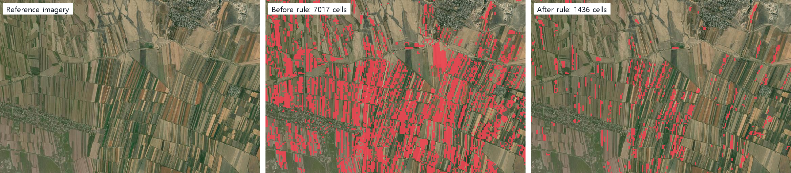
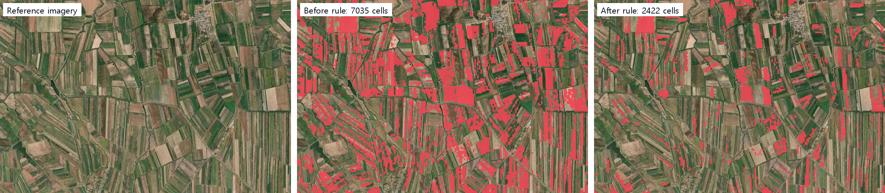

# 해외 결과 정확도 점검 · 보이기 (10-18 now 답 · 원칙 287)

브리핑 확인: (1) **숫자 한 출처(규칙 3-3)** — 작황 하락은 서버 보관 한 곳(규칙이 바뀌면 열쇠가 바뀌어 새 값 한 번만 잼)에서 첫 화면 · XI ChatGEO 가 같은 값(31.5㎢ = 31.5㎢)을 씁니다. 경작지 장부(12,536㎢ · 이식아타 64,763ha)는 바꾸지 않았습니다. (2) **내부 지표 과장 금지(규칙 3-2)** — 큰 숫자를 '수확 시기 차이'까지 센 147.5㎢ 에서 확실한 하락만 센 31.5㎢ 로 낮췄고, 화면에 'AI estimate' 를 붙였습니다. (3) **장비 규칙** — GPU 다시 돌리기 없음(전부 CPU · 받은 영상) · 게이트웨이만 `start-landxi.ps1 -Restart gateway` · Ollama · vLLM 그대로.

사용자 말: "근데 정확도가 너무 떨어지는 것 같은데?" · "지금 화면 자체가 잘 안보이는데"

그림: 이 폴더 — 바깥 주소 해외 기관 로그인 폼(PC 1440 · 모바일 390). 파일 끝 네 자리 = 찍은 시각(10-18). `-before-` 는 now 페이지에 올렸던 그림(10-18 08:23) · 어제 그림(10-17 22:57). 나란히 그림(`crop-*` · `drop-*`)은 왼쪽 = 참고 항공 영상(Esri World Imagery · 촬영 시기 다름), 가운데 = 고치기 전, 오른쪽 = 고친 뒤 · 줌 13.

## 1. 무엇이 틀렸나 (숫자)

| 결과 | 문제 | 크기 |
|---|---|---|
| **작황 하락(첫 화면 큰 숫자)** | '계절 평균 NDVI 가 작년보다 0.1 낮으면 하락' 한 줄 규칙이라 **수확 시기 차이**(올해 9월에 먼저 거둔 밭)까지 하락으로 셌다 | 이식아타 147.5㎢ 중 **74%**가 9 · 10월 두 달 중 한 달만 낮은 칸 · 25%는 작년에도 푸르지 않던 밭(NDVI < 0.3) · 소쿨룩 65% · 알라무둔 73% 같은 모양 |
| 작황 하락 — 반대쪽 잡음 | 같은 규칙으로 '작년보다 0.1 이상 푸른' 밭도 43.6㎢ — 해마다 바뀌는 작물 · 시기만으로 이만큼 흔들린다 | 147.5㎢ 의 약 30% |
| **경작지 지도 — 9군 빈 칸** | 공개 지도 값을 쓰는 고지대 9군(At-Bashy · Toktogul · Tong · Kochkor · Alay · Chatkal · Kara-Kulja · Chong-Alay · Bazar-Korgon)의 지도 칸을 비슈케크 둘레만 덮은 파일에서 읽어 **지도에 통째로 비어** 있었다(장부 숫자는 맞음) | 장부 1,242㎢ 인데 지도 0.5㎢ · 나라 전체 지도 10,954㎢ vs 장부 12,536㎢(−13%) |
| 경작지 지도 — 굵은 칸 | 가까이(줌 12–14)도 약 57 m 칸을 키워 그렸고, 칸 안 경작지가 5%만 있어도 칸 전체를 칠했다 → 마을 · 길 · 비탈까지 덮임 | 10 m 결과를 57 m 로 보여 줌 |
| 경작지 — 모델 자체 | 공개 지도 둘(Esri 2025 · WorldCover 2021) 평균과 30% 넘게 다른 군 6곳: Toguz-Toro 1.54배 · Suzak 1.48배 · Chong-Alay 1.44배(공개 지도 둘끼리도 2.6배 차이) · Issyk Kul 0.61배 · Kara-Kulja 0.66배 · Tomok 0.58배. 그림에서 산 비탈 풀밭 · 강바닥 자갈밭을 경작지로 칠한 곳이 보임(모델 · 공개 지도 모두) | 나라 합계는 공개 지도 평균의 0.96배(12,536 vs 13,007㎢) — 합계는 맞고 군별 · 칸별이 흔들림 |
| 건물 면적 변화 | 2017 영상은 처리 기준이 다른 옛 판이라 우리 모델이 2017 건물을 덜 잡음(알라무둔 39→68 · 소쿨룩 53→97㎢ 처럼 늘어남이 큼). 2025 건물 넓이는 나라 합계 1,789㎢ — WorldCover 1,505 와 비슷, Esri 3,827 의 절반 | 고치려면 2017 다시 돌리기(제안) |
| 정렬 | 칸과 영상 어긋남은 보이지 않음(밭 줄 · 길과 칸 경계가 맞음 — `crop-*` · `drop-*`) | — |

공식 통계: 키르기스스탄 국가 통계의 군별 파종 면적은 아직 받아 두지 않아 비교하지 못했습니다(지어내지 않음). 받으면 Register 탭(구역 대장 × AI)에 올려 바로 대조됩니다.

### 군별 경작지 — 장부 · 공개 지도 둘 · 지도에 그려진 넓이(⚠ = 공개 둘 평균과 30% 넘게 다름)

| 군 | 주 | 쓰는 값 | 장부 경작지(㎢) | Esri 2025 | WorldCover 2021 | 공개 둘 평균 대비 | 지도에 그려진 넓이 전 → 후(㎢) |
|---|---|---|---:|---:|---:|---:|---:|
| Tong | Issyk-Kul | 공개 지도(Esri) | 159.7 | 159.7 | 217.9 | 0.85 | 0.0 → 177.8 |
| Bazar-Korgon | Jalal-Abad | 공개 지도(Esri) | 205.4 | 205.4 | 269.2 | 0.87 | 0.4 → 210.5 |
| Chatkal | Jalal-Abad | 공개 지도(Esri) | 50.7 | 50.7 | 49.3 | 1.01 | 0.0 → 51.0 |
| Toktogul | Jalal-Abad | 공개 지도(Esri) | 189.8 | 189.8 | 188.5 | 1.00 | 0.0 → 192.6 |
| At-Bashy | Naryn | 공개 지도(Esri) | 232.6 | 232.6 | 129.6 | 1.28 | 0.0 → 237.0 |
| Kochkor | Naryn | 공개 지도(Esri) | 226.0 | 226.0 | 305.1 | 0.85 | 0.0 → 254.4 |
| Alay | Osh | 공개 지도(Esri) | 26.6 | 26.6 | 30.6 | 0.93 | 0.0 → 28.2 |
| Chong-Alay | Osh | 공개 지도(Esri) | 108.8 | 108.8 | 42.1 | 1.44 ⚠ | 0.0 → 110.2 |
| Kara-Kulja | Osh | 공개 지도(Esri) | 42.8 | 42.8 | 87.8 | 0.66 ⚠ | 0.1 → 46.7 |
| Batken | Batken | AI 모델 | 98.7 | 98.9 | 130.6 | 0.86 | 94.4 → 94.4 |
| Kadamjay | Batken | AI 모델 | 189.9 | 164.1 | 191.6 | 1.07 | 186.2 → 186.2 |
| Leilek | Batken | AI 모델 | 269.1 | 158.4 | 319.9 | 1.13 | 264.7 → 264.7 |
| Alamudun | Chuy | AI 모델 | 367.2 | 406.6 | 346.0 | 0.98 | 334.7 → 334.7 |
| Chuy | Chuy | AI 모델 | 429.6 | 503.2 | 407.4 | 0.94 | 431.1 → 431.1 |
| City of Tomok | Chuy | AI 모델 | 1.7 | 2.6 | 3.3 | 0.58 ⚠ | 2.1 → 2.1 |
| Jayyl | Chuy | AI 모델 | 692.4 | 719.4 | 718.9 | 0.96 | 643.0 → 643.0 |
| Kemin | Chuy | AI 모델 | 118.3 | 172.0 | 132.9 | 0.78 | 117.5 → 117.5 |
| Moskva | Chuy | AI 모델 | 607.5 | 684.0 | 653.0 | 0.91 | 573.0 → 573.0 |
| Panfilov | Chuy | AI 모델 | 532.2 | 739.0 | 599.9 | 0.79 | 490.0 → 490.0 |
| Sokuluk | Chuy | AI 모델 | 794.1 | 909.8 | 854.5 | 0.90 | 785.1 → 785.1 |
| Ysyk-Ata | Chuy | AI 모델 | 647.6 | 747.9 | 634.8 | 0.94 | 634.3 → 634.3 |
| Ak-Suu | Issyk-Kul | AI 모델 | 454.4 | 584.1 | 520.1 | 0.82 | 443.7 → 443.7 |
| Issyk Kul | Issyk-Kul | AI 모델 | 161.6 | 304.3 | 222.4 | 0.61 ⚠ | 161.1 → 161.1 |
| Jeti-Oguz | Issyk-Kul | AI 모델 | 277.9 | 395.8 | 328.3 | 0.77 | 280.2 → 280.2 |
| Tup | Issyk-Kul | AI 모델 | 372.8 | 498.5 | 431.0 | 0.80 | 369.4 → 369.4 |
| Aksy | Jalal-Abad | AI 모델 | 209.4 | 141.1 | 239.4 | 1.10 | 200.1 → 200.1 |
| Ala-Buka | Jalal-Abad | AI 모델 | 192.1 | 172.3 | 193.7 | 1.05 | 188.9 → 188.9 |
| Nooken | Jalal-Abad | AI 모델 | 366.5 | 299.2 | 324.1 | 1.18 | 337.7 → 337.9 |
| Suzak | Jalal-Abad | AI 모델 | 708.2 | 371.0 | 588.0 | 1.48 ⚠ | 689.1 → 689.2 |
| Ak-Talaa | Naryn | AI 모델 | 148.6 | 120.2 | 196.5 | 0.94 | 151.0 → 151.0 |
| Jumgal | Naryn | AI 모델 | 158.8 | 246.1 | 181.2 | 0.74 | 159.0 → 159.0 |
| Naryn | Naryn | AI 모델 | 269.0 | 244.7 | 233.2 | 1.13 | 267.5 → 267.5 |
| Toguz-Toro | Naryn | AI 모델 | 78.3 | 31.9 | 70.0 | 1.54 ⚠ | 78.4 → 78.4 |
| Aravan | Osh | AI 모델 | 274.2 | 250.8 | 244.9 | 1.11 | 257.0 → 257.0 |
| Kara-Suu | Osh | AI 모델 | 729.1 | 493.5 | 690.0 | 1.23 | 701.3 → 701.3 |
| Nookat | Osh | AI 모델 | 334.2 | 253.6 | 333.6 | 1.14 | 318.8 → 318.8 |
| Uzgen | Osh | AI 모델 | 569.0 | 503.6 | 627.6 | 1.01 | 574.5 → 574.6 |
| Bakay-Ata | Talas | AI 모델 | 327.6 | 384.7 | 370.9 | 0.87 | 322.8 → 322.8 |
| Kara-Buura | Talas | AI 모델 | 435.7 | 534.0 | 468.6 | 0.87 | 428.1 → 428.1 |
| Manas | Talas | AI 모델 | 205.9 | 222.6 | 199.3 | 0.98 | 196.5 → 196.5 |
| Talas | Talas | AI 모델 | 272.3 | 348.5 | 290.2 | 0.85 | 272.6 → 272.6 |
| **합계 41군** | | | **12,536.3** | 12,948.6 | 13,066.1 | 0.96 | 10,954.3 → 12,262.6 |

(나라 합계 지도 넓이가 장부보다 2% 적은 것은 칸 안 비율로 그린 지도와 결과 면 넓이의 차이 · 조각 경계 — 숫자는 장부 한 곳에서만 나옵니다)

### 작황 하락 — 규칙 바꾸기 전 · 후 (가을 2025 · 9–10월 vs 2024 같은 달)

| 군 | 경작지(지도 바탕) | 전 규칙 | 두 달 중 한 달만 낮음 | 작년에도 푸르지 않음 | **새 규칙** |
|---|---:|---:|---:|---:|---:|
| Ysyk-Ata | 634.3㎢ | 147.5㎢ | 74% | 25% | **31.5㎢** |
| Sokuluk | 785.1㎢ | 169.9㎢ | 65% | 25% | **49.1㎢** |
| Alamudun | 334.7㎢ | 54.4㎢ | 73% | 31% | **10.3㎢** |

새 규칙(쉬운 말): **작년 같은 계절에 푸르렀던 밭이, 이번 계절 대부분의 달(두 달이면 두 달 모두)에서 작년 같은 달보다 덜 푸르고, 4분의 1 이상 덜 푸르며, 옆 칸과 함께 있을 때만** '작황 하락'으로 셉니다. 바깥 주소 첫 화면 31.5㎢ = 계산기(`data/drop_diag.py`, 같은 영상 타일) 31.5㎢ = XI ChatGEO 답 "estimated at 31.5 km²".

### 경작지 — 줌 13 나란히
- `crop-ysyk-ata-z13.png` — 고친 뒤 밭 모양을 따라 그림. 다만 산기슭 풀밭 일부를 여전히 경작지로 봄(모델 한계).
- `crop-suzak-z13.png` · `crop-toguz-toro-z13.png` — 공개 지도보다 1.5배 많은 군. 강을 따라 난 밭은 맞고, 강바닥 · 마을 가장자리가 섞임.
- `crop-at-bashy-z13.png` — 고치기 전 빈 칸(가운데) → 고친 뒤 공개 지도 값이 보임(오른쪽). 공개 지도도 강바닥 자갈밭을 경작지로 칠한 곳이 있음.

## 2. 고친 것 (안전 · CPU 만)

| 무엇 | 어떻게 | 증거 |
|---|---|---|
| 작황 하락 규칙 | 위 새 규칙(달마다 · 작년 푸르름 · 4분의 1 · 외톨이 칸 뺌). 규칙 이름이 보관 열쇠에 들어가 예전 147.5 보관 값은 다시 쓰이지 않음 → 첫 화면 · XI ChatGEO 모두 31.5㎢ | `ov-first-after` · `ov-chat-after` · `drop-*` |
| 'AI 추정' 말 · 빨강 뜻 | 큰 숫자 아래 흰 칩 한 줄 **"Red: fields less green than Sep–Oct 2024 · AI estimate"** (모바일은 'AI estimate' 가 다음 줄로 한 덩어리) · 호버 설명도 같은 말 | `ov-first-after` · `legend-390-local`(줄바꿈 고친 뒤 로컬 그림) |
| 9군 빈 칸 | 공개 지도 값을 군마다 받아 둔 파일에서 읽음 → 9군이 지도에 보임(장부 1,242㎢ · 지도 1,308㎢) · 나라 지도 10,954 → 12,263㎢ | `ov-country-after` · `crop-at-bashy-z13` |
| 가까이 고운 칸 | 줌 12–14 는 새로 구운 약 14 m 칸(6,320장 · 같은 모델 결과)으로 그리고, **칸의 절반 이상이 경작지일 때만** 칠함(자신 없는 가장자리 칸 숨김). 멀리(≤11)는 그대로 | `crop-*-z13`(오른쪽) · XI맵 · 메인도 같은 서버 조각 |
| 바탕 · 결과 대비 | 군에 들어가면 위성 바탕 채도만 낮춤(밝기 그대로 · 딤 아님 · 법전의 '저채도 지도'와 같은 값대) → 빨강이 갈색 산 · 밭과 섞이지 않음. 가까이 빨강 칸의 흰 테두리 없앰(좁은 밭에서 흰 선이 칸을 덮어 어수선) | `ov-first-before-0823` ↔ `ov-first-after` · `ov-nearer-before-2257` ↔ `ov-nearer-after` |

바꾼 숫자: 작황 하락(이식아타 · 가을 2025) 147.5 → **31.5㎢** (한 출처 = 서버 보관 · 첫 화면과 XI ChatGEO 같음). 경작지 장부 · 군별 넓이 · 건물 면적 변화는 그대로.

## 3. 남은 것 (다시 돌리기 필요 — 제안)
1. **경작지 모델 다시 학습** — 고지대 · 산기슭 풀밭과 강바닥을 '경작지 아님'으로 더 가르친 뒤 나라 전체 다시 돌리기. 공개 지도 9군도 우리 결과로 되돌릴 수 있음. GPU 한 장 · 70% · 140W 아래, 작업 대기열로(전국 작업기와 번갈아).
2. **작황 하락을 10 m 로** — 지금은 약 57 m 칸(브라우저가 영상 조각 120장으로 계산). 서버에서 10 m 로 한 번 재서 보관하면 밭 하나 단위로 보임(CPU 작업 · GPU 불필요).
3. **건물 2017 다시 돌리기** — 2017 영상을 2025 와 같은 처리 기준으로 받아 다시 돌려야 '늘어남'이 믿을 만해짐(GPU · 4군).
4. 공식 통계(군별 파종 면적) 받아 Register 탭 대조.

## 파일
- 화면: `landxi/v3/global/ndvi-tiles.js`(규칙 r2 · 가까이 한 빨강) · `app.js`(보관 열쇠에 규칙 · 범례 · 채도) · `global.css`(범례) · `landxi/v3/kit/ov-crop.js`(보기 조각 주소에 판 표시 — 브라우저에 남은 옛 조각 안 씀)
- 서버: `server/overseas/croptiles.py`(공개 지도 군 파일 · `--z 13`) · `server/landxi_api/global_data.py`(줌 12–14 고운 조각 · 절반 기준)
- 데이터: `02. 데이터/overseas/kgz/2025/publish/crop-z11`(다시 구움 · 9군 칸 846장) · `crop-z13`(새 6,320장)
- 점검 도구 · 결과: `data/`(군별 표 · 작황 하락 재현 · 나란히 그림) · 촬영기 `shoot.mjs`
